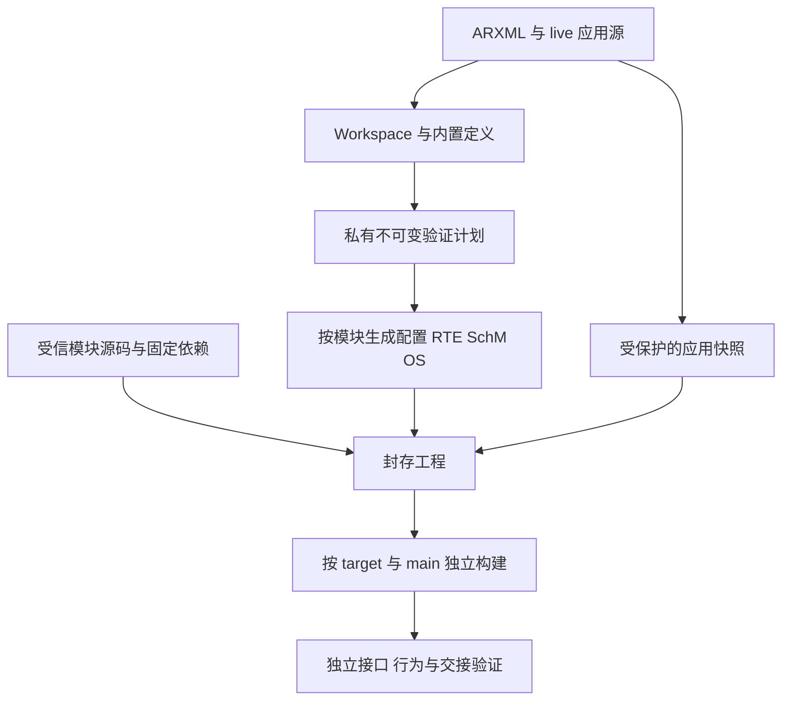
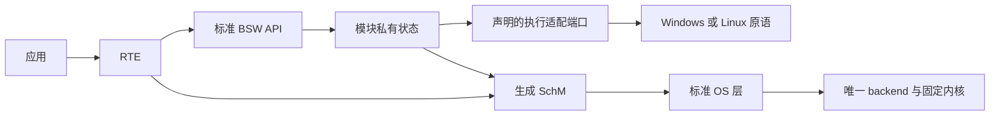

# Epic 9 增量架构契约

## Design Paradigm

沿现有分层编译链采用端口与适配器：源文件与配置语义由 Rust 核心拥有；C 模块拥有运行状态；主机平台原语位于适配层。基线、迁移 seed、工作包及未核查边界见 [BASELINE](BASELINE.md)。本文件定稿只表示架构材料完成，不表示整改、Story 就绪或标准符合。



## Inherited Invariants

继承根 [architecture.md](../../architecture.md) 当前整改约束；历史 Epic spine 保持只读，不将历史范围扩张为当前符合声明。这里的引用 ID 带原 Epic 命名空间，本文件 AD ID 仅属于 Epic 9。

| Inherited | From parent / existing constraint | Binds here |
| --- | --- | --- |
| Epic 4 AD-1、AD-2 | [Epic 4](../epic-4/ARCHITECTURE-SPINE.md) | 原字节权威、输入角色与唯一验证计划 |
| Epic 4 AD-6、AD-8 | 同上 | 唯一 FreeRTOS backend、汽车状态、受控 tick 和调度边界 |
| Epic 4 AD-5 | 同上 | 完整 SC1 等级义务、真实执行栈与 ARTI，不缩为参考对象子集 |
| Epic 4 AD-7 | 同上 | 目标、工具链、许可及独立证据 |
| Epic 7 AD-1、AD-3–AD-6、AD-9、AD-10 | [Epic 7](../epic-7/ARCHITECTURE-SPINE.md) | 对象身份、定义与语义区分、ChangeSet、安全保存、源码拥有权及规则身份 |
| Epic 7 AD-2 | 同上 | 内置配置能力不依赖用户官方档案／编译器，按动作报告能力与执行范围 |
| Epic 7 AD-8、AD-11 | 同上 | Session／reducer 状态权威、正常部署及隔离原生验证 |
| Epic 8 AD-1–AD-9 | [Epic 8](../epic-8/ARCHITECTURE-SPINE.md) | 实例与端点、local/network 区分、同 owner 调度、profile ABI、每组件快照及 R11 接缝 |

## Invariants & Rules

### AD-1 — profile、target 与程序闭包 [ADOPTED]

- **Binds:** QLT-1、QLT-2；资产选集、生成及离线构建。
- **Prevents:** 同一能力多套实现、同名头文件误选、多个 main 混合链接或 Windows 结果替代 Linux。
- **Rule:** 只有一条生成主线，SWC 数为 1 与多于 1 走同一计划与 emitter，不按组件数分派不同链路；target 独立选择，不同时链接互斥 OS／RTE／BSW producer。旧 profile（`host-can-v1`、单组件 profile）不再分派，识别后明确拒绝。封存 target 的 source/include/宏/patch/main 清单是构建与分析共同输入。host、host-batch、probe、test 的实际程序闭包分别核验；六种 CI 样本是最低覆盖，不是所有支持配置。新增或改变选集须同步正常样本、模式测试与交付清单。

### AD-2 — 模块状态与接口边界

- **Binds:** QLT-1–QLT-3；BSW、OS、RTE、ECU 与 host adapter。
- **Prevents:** 两模块拥有同一可变状态，拆文件后丢失锁协议，标准公开头文件吸入 host／测试控制。
- **Rule:** 每个协议模块拥有自身状态和静态配置引用；RTE 拥有 local 数据及初始／发布状态；OS/backend 拥有调度，ECU adapter 拥有批次 admission、队列与收据。标准公开面、模块私有声明及 host 注入／时钟／输出分别组织；私有状态不向应用暴露。标准上下层回调依模块专用声明连接；真实异步 CAN、CanIf、ComM、BswM 共享状态沿既有 SchM exclusive area 保护，不能以 owner 假设取消锁。BSW 不新增直接平台线程或 FreeRTOS 依赖；资源通过已声明适配边界提供，故障控制只在测试构建。



### AD-3 — 单一语义来源与模块 emitter

- **Binds:** QLT-2；配置模型、内置定义、Rust 渲染器及 C 模板。
- **Prevents:** 渲染器重新解释配置、字符串修补形成第二套语义、ABI 类型与配置表漂移。
- **Rule:** ARXML／manifest 保持持久权威，定义描述合法结构，验证计划核定语义和身份；emitter 只消费计划。按模块组织配置、公开类型、回调、BSWMD、MemMap 和 producer/consumer 生成，保留确定顺序。COM→RTE 等跨模块 callback／类型／配置 glue 的唯一 producer、符号、声明和消费路径由对应契约一次核定，其他 emitter 只引用；相关 Story 进入前共同独立 consumer 必须编译链接闭合。将决定配置／接口的最终 C 文本搜索替换逐步移入结构化计划字段及模块 emitter；纯占位模板渲染可保留。资产来源到交付路径必须显式映射并拒绝碰撞、遗漏或多个 producer；普通生成不运行编译器或读取官方档案。每个输出文件登记唯一生成方；跨模块需要写入同一文件的内容（MemMap 段、SchM 声明、类型补充）在计划阶段汇总后交给该生成方。emitter 不回读或修补已生成的 C 文本，不 panic；计划无法保证的前提返回 `PlanDiagnostic`。（2026-10-11 补充）

### AD-4 — 兼容迁移是一个完整变更

- **Binds:** QLT-2、QLT-3；调用方、用户源码、ABI、资产与离线工具。
- **Prevents:** 只改输出、不改来源；用摘要更新追认接口变化；再生成覆盖用户代码或封存包静默升级。
- **Rule:** 每次模块迁移先有独立接口／行为护栏，再同步源码与模板、配置语义及定义、所有调用方、清单与正常测试。保留 live/sealed 分离、create-only 初始化、预览确认失效、所有权和完整性拒绝。稳定版本发布前不保留旧 profile／旧格式的兼容：公开签名、布局、句柄语义、wire 或交付格式变化须经 ABI／第三方身份审阅并写入 CHANGELOG，旧工程和旧封存包被明确拒绝，不静默误解析、不改写、不重写摘要；新版本不以重命名旧接口宣称标准化。稳定版本后的兼容策略另行确定。（2026-10-11 修订，原规则要求兼容分析与显式迁移。）

### AD-5 — 标准与诊断的证据边界 [ADOPTED]

- **Binds:** QLT-1、QLT-3；标准研究、自动检查、人工审查和采用代码。
- **Prevents:** 绿色 CI、编号库存、扫描完整性或标准名称被当作符合性；第三方代码自动排除。
- **Rule:** 固定 CP/FO R24-11、MISRA C:2012 Third Edition＋AMD1–AMD4＋TC1–TC2 与 C99。每个模块按支持配置核对 SWS、ECUC、通用 BSW、条件适用描述／MemMap、公开接口及全部直接上下层义务。诊断分别核定真实违反、误报、不适用与未核查；原始结果保留，221 项人工 assessment 不能由工具可用性关闭。固定内核／port／patch 纳入实际责任链；无法消除真实违反或缺合法依据时阻塞对应退出，禁止批量 suppression、规则降级、缩小既有支持；本轮无偏离批准。

### AD-6 — 独立预期与正常开发入口 [ADOPTED]

- **Binds:** QLT-4；快速反馈、模块、生成、进程、原生与交接验证。
- **Prevents:** 测试复写被测实现、删除不同风险覆盖、仅 mock／构建成功替代真实操作。
- **Rule:** 用现有 npm、Cargo、uv、autosar_tooling 与离线 ecu-tool 入口；按改动选择检查，完整出口再覆盖全部受影响层。标准预期从固定原文与独立向量定义，ABI 清单只能验证内部一致性。模块契约覆盖初始化、成功、拒绝、超时／恢复、重复调用、失败后字节与输出保护、实际并发路径；维护旧 profile 行为。数据、build、进程、桌面及日志隔离，前置工具先核对，缺条件明确未执行。native／IPC、安装包、离线接收者和硬件结论分别取证；只证明相同风险覆盖后才删除重复测试，不另建代理编排。测试与预期一律放在 cargo test、unittest、vitest 或 node:test 中，以 feature／标记区分运行条件，不做成开发 CLI 子命令；桌面端到端优先使用 Tauri 官方 WebDriver 与 runner 级隔离。（2026-10-11 补充）

### AD-7 — 完整源码门禁与性能基线

- **Binds:** QLT-5；Actions 分组、缓存、聚合与分支保护。
- **Prevents:** 丢样本换速度、旧扫描结果缓存为通过、非必需状态无法阻止合并。
- **Rule:** 保留两平台完整主线样本（9.24 重定，覆盖单 SWC 与多 SWC）与每个实际 main 的分析闭包，每次生成和分析本轮输入；缓存只复用可信依赖／构建中间物，按 runner/target/toolchain/source identity 隔离。严格门禁同时要求完整选集、error=null、passed=true、上游全部 success；缺失、重复、skip、cancel、工具／解析失败均不能通过。整改完成后将严格检查接入每次 PR 的 c-analysis 聚合，并将其加入必需分支状态；用故意违规、缺样本和工具失败的实际 PR 验证阻断，再恢复干净输入。优化用可比完整运行的 job/step、队列、缓存命中、稳定性及资源消耗评估，不预承诺百分比或只延长超时；新增门禁成本与优化收益分别按同覆盖、同工具身份核定，说明合计变化与差异原因。

### AD-8 — 分阶段退出与依赖 [ADOPTED]

- **Binds:** Epic 9 工作包、Story 拆分与 R11 进入。
- **Prevents:** 为未知数量生成空故事，单模块通过冒充 Epic 出口，人工问题集中延期。
- **Rule:** 先完成 9.21–9.28 新基线（单一主线、删除平行实现、测试与工具归位、去编号与按职责命名、生成与静态检查门槛、按所有权组织生成工程），再进入模块整改；[BASELINE 工作包](BASELINE.md#迁移工作包与-story-进入)固定模块范围和依赖；每个模块包先补对应规范与独立预期，再实施来源／调用链／资产迁移，伴随 MISRA 核定和人工审查。测试／性能调查可独立并行；共享 API 变更由一个包拥有，消费者待该契约固定后迁移。严格门禁、兼容审阅和非实现者新目录复验全部通过才关闭 Epic 9，R11 消费者实施等待本出口；研究可提前。规格状态和标准结论分别更新。

### AD-9 — 工程基线：命名、工具与门槛

- **Binds:** QLT-2、QLT-4；目录与模块命名、开发工具、静态检查、构建组织与格式标识。
- **Prevents:** 开发计划编号固化为产品身份；“multi／legacy”这类相对命名在收敛后失去意义；测试绕开正常运行器；规范只写在文档里而无法被检查。
- **Rule:** 产品代码、测试、fixture、工具、bin、目录名、测试名与读者文档不出现 Epic／Story 编号，由 `quality` 检查强制；历史 BMad 记录不改。目录与模块按职责命名，不用 multi、legacy、new 等相对词。仓库工具只分三类：交付工具、统一开发 CLI（`doctor`、`verify`、`quality`、`c-check`、`assets`）、正常运行器中的测试。根目录为 Cargo workspace，不为未稳定的边界预先拆 crate。clippy 启用默认集，生成与集成模块 deny `unwrap_used`、`expect_used`、`panic`，其余模块按记录的基线只减不增。只有持久化或交付格式带版本，并登记在格式版本表中；内部标识（如模板 ID）不带版本。

## Capability → Architecture Map

| 项目需求 | 落点 | 约束 |
| --- | --- | --- |
| QLT-1 范围／标准 | profile-target-program 来源、模块与合法资料 | AD-1、AD-2、AD-5 |
| QLT-2 组织／来源 | 单一主线、模块 emitter、私有头、host 边界、按职责命名 | AD-1–AD-4、AD-9 |
| QLT-3 整改／人工 | 源诊断分类、采用代码及未核查出口 | AD-4、AD-5、AD-8 |
| QLT-4 开发／测试 | 正常入口、独立预期及隔离 | AD-1、AD-6 |
| QLT-5 CI | 完整分析、缓存、严格必需门与耗时复验 | AD-7、AD-8 |

## Structural Seed

2026-10-11 修订。依据见下方“组织依据”；最终名称由 9.26 裁定并经用户审阅，改名必须随来源、资产、CI、文档同步。未改变 Rust／React／Tauri／Python 技术栈或固定内核。部署仍为 Windows/Linux controlled host，无新增服务、provider、常驻代理、联网运行依赖。

```
Cargo.toml            # 虚拟 manifest：members = ["core", "src-tauri"]，resolver = "3"，唯一 Cargo.lock 与 target
core/
  build.rs            # 只写 OUT_DIR
  resources/          # 产品内置资源，如 templates/standard-ecu/*.arxml
  src/{arxml,definitions,rules,integration,generator,execution}/
    integration/      # 去掉 multi_ 前缀，按职责命名，如 components、bsw、com、mode、rte、ecu_files
  tests/
    it/main.rs        # 普通集成测试，一个测试二进制，内部按能力分模块
    native/main.rs    # required-features = ["native-tests"]，内部分 runtime_contracts、integration_contracts 等模块
    official/main.rs  # required-features = ["official-oracles"]
    support/          # 按功能命名的共享辅助
    fixtures/<能力>/  # 输入与期望放在一起
src-tauri/            # 位置与名称不变，作为 workspace 成员
runtime/
  bsw/include/        # 标准公共头与 <Mip>_MemMap.h
  bsw/src/            # <Mip>.c 与私有头 <Mip>_Internal.h
  os/  ecu/  host/    # host 只放主机适配，不改标准头
tools/python/src/  tests/python/  tests/desktop/   # 位置不变
```

| 选择 | 理由 |
| --- | --- |
| 根目录 workspace，`core`、`src-tauri` 不搬到 `crates/` | 只有两个 crate，搬迁收益小于对 Tauri CLI、CI 和文档的影响；crate 增多后再迁到 `crates/` |
| 不拆新 crate | 边界仍在变化；拆分的收益主要是编译并行与边界约束，待边界稳定后再评估 |
| `core/resources/` | 产品不依赖测试目录；`include_str!` 路径与 `.gitattributes` 规则同步迁移 |
| `integration` 按职责命名 | 与成熟编译器／生成器按阶段与职责组织一致 |
| `core/tests` 按运行条件收成少数几个测试二进制 | 每个顶层测试文件都单独链接一次；CI 改为按模块过滤，例如 `--test native -- runtime_contracts::` |
| `runtime/bsw` 扁平 | 目前约 12 个模块，SWS 不规定目录，`<Mip>` 前缀已足以区分；模块数接近 30 时再考虑按 communication／diagnostic 等分层 |
| `_Cfg`／`_PBcfg` 只出现在生成工程 | 配置与模块源码分开 |

**组织依据（2026-10-11 调研）：**
- Cargo 的 workspace 只认根目录的锁文件和 target，`[profile]`／`[patch]` 只在根 manifest 生效，虚拟 manifest 须显式写 `resolver`：[Cargo Workspaces](https://doc.rust-lang.org/cargo/reference/workspaces.html)。Tauri 2 明确允许 `src-tauri` 作为 workspace 成员：[Tauri Project Structure](https://v2.tauri.app/start/project-structure/)。
- 大型 Rust 工程用扁平布局和虚拟 manifest；集成测试合并成一个二进制可明显减少编译与链接开销（作者自述为经验而非权威）：[Large Rust Workspaces](https://matklad.github.io/2021/08/22/large-rust-workspaces.html)、[Delete Cargo Integration Tests](https://matklad.github.io/2021/02/27/delete-cargo-integration-tests.html)；多文件集成测试写成 `tests/<name>/main.rs` 加子模块：[Cargo Package Layout](https://doc.rust-lang.org/cargo/guide/project-layout.html)；`required-features` 控制按 feature 编译的测试目标：[Cargo Targets](https://doc.rust-lang.org/cargo/reference/cargo-targets.html)；build script 只写 `OUT_DIR`：[Build Scripts](https://doc.rust-lang.org/cargo/reference/build-scripts.html)。
- 生成器与编译器按阶段和职责命名模块，期望输出与用例放在一起并人工审阅：[rustc compiler](https://github.com/rust-lang/rust/tree/HEAD/compiler)、[cbindgen](https://github.com/mozilla/cbindgen/tree/master/src/bindgen)、[Cranelift](https://github.com/bytecodealliance/wasmtime/tree/main/cranelift)、[rustc UI tests](https://rustc-dev-guide.rust-lang.org/tests/ui.html)。golden 输出不替代从 AUTOSAR 契约独立定义的预期。
- SWS BSW General R24-11（本地固定副本核对）：5.1 节说明不完整规定 BSW 模块的文件结构，但未列出的实现文件名也须遵守 [SWS_BSW_00103]；[SWS_BSW_00006] 要求实现源包含 `<Mip>_MemMap.h`；[SWS_BSW_00170]／[SWS_BSW_00171] 要求文件名区分大小写且不能只靠大小写区分。规范未规定目录结构，所以改名只能动目录与项目私有名称，标准文件名不变。
- 开源 AUTOSAR 栈：[openAUTOSAR/classic-platform](https://github.com/openAUTOSAR/classic-platform) 按层再按模块分目录，模块内 `inc/`、`src/`，配置放在 board 配置目录；[autoas/as](https://github.com/autoas/as) 也按层分，但公共头集中放置。两者在公共头位置上做法相反，一致之处是私有头与 `.c` 同处、配置不进模块源码。

**生成工程布局（9.28，2026-10-11 调研）：**交付包按所有权分目录，标准文件名不变。

```
<工程>/
  bsw/{include,src}/        静态 BSW，只读，受资源摘要约束
  os/  kernel/              静态 OS 适配与固定第三方内核
  generated/{include,src}/  全部配置生成物：*_Cfg.h、*_PBcfg.c、Rte*、SchM_*、*_MemMap.h、Ecu 配置；每次生成整体重写
  generated/templates/      SWC 骨架，不参与编译
  app/<SWC>/                用户代码快照（用户在 live 工程中修改）
  integration/              主机／目标适配
  CMakeLists.txt  target.json   从同一清单生成的标准构建描述与 ecu-tool 构建清单
  tools/  inputs/  meta/    离线复验工具、原始输入、台账与完整性清单
```

依据：商用与开源工具普遍把静态代码、整体可重写的生成目录和用户代码分开存放，并提供标准构建入口——[Vector DaVinci Configurator Classic 目录结构](https://help.vector.com/davinci-configurator-classic/en/current/dvcfg-classic/6.2/configuration/projects/directory-structure.html)（`GenData`、`Templates`，静态 BSW 在工程外的 BSW 包）；EB tresos 的 `output/generated`（官方材料仅确认 `include`、`orti` 子目录，例如 [TASKING 应用说明](https://www.tasking.com/wp-content/uploads/2025/05/AN_iSYSTEM_EB_AutoCore_Profiling.pdf)）；NXP S32DS 的 `generate/{include,src}`；[openAUTOSAR/classic-platform](https://github.com/openAUTOSAR/classic-platform) 的板级 `config/`；[autoas/as](https://github.com/autoas/as) 的 `GEN/`。商用工具内部细节多未公开，只采用各来源一致的做法。R24-11 Memory Mapping 规定 `{Mip}_MemMap.h` 与 `{componentTypeName}_MemMap.h` 由 Memory Mapping 按输入配置提供（[SWS_MemMap_00032]／[SWS_MemMap_00029]，本地固定副本核对），所以主机目标的 MemMap 头归入 `generated/`；接入 MCU 目标时，集成层可通过显式配置声明覆盖，不手改生成文件。用户代码以快照形式进入交付包，是 Epic 7 源码所有权设计的有意选择，与在工程目录里直接写代码的常见做法不同。

**不做：**不把超大测试文件拆成许多顶层 `tests/*.rs`；合并 workspace 后不保留子目录中的 `Cargo.lock`；不为整齐而拆 crate；不建只有一两个模块的分层空目录；不让 `build.rs` 写入源码树；不改名或移动 `src-tauri`；不让 golden 输出自动覆盖。

## Deferred

- 模块内精确文件粒度由其 Story 在调用链证据下确定，必须遵守 AD-2/3；不预建所有可选模块目录。
- 合法规范全文获取、模块完整适用性、诊断分类及 221 项人工审查是后续进入与退出依赖，见 BASELINE 未核查项；不能用本架构定稿解除。
- 稳定版本后的兼容与迁移策略待首个稳定版本发布前确定；在此之前按 AD-4 不保留旧格式兼容，但任何契约变化都须审阅并记入 CHANGELOG。
- CI 是否新增更细分组，待阶段日志和成本证据确定；CTU 不拆散同一程序，样本／目标／main 不减少。
- MCU、真实硬实时、真实 ISR／段放置、完整 NM／CanSM、新类型及通道由各自后续增量处理；已支持配置中的通用软件义务不得据此延期到 Epic 10。
