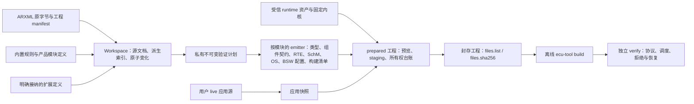
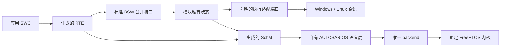

# 架构

本文描述 Classic CAN 配置工作台的**当前**架构、仍然有效的所有权与状态不变量，以及正在实施的主线收敛方向。标注“目标（实施中）”的内容尚未在 `master` 落地，不能当作现有能力；其余段落描述当前代码。重大决定的背景与取舍见 [ADR](adr/)，本文只给出结论并链接。

运行时细节、命令和标准条款不在本文重复：

- 运行时与主机执行边界：[runtime/README.md](../runtime/README.md)、[runtime/os/README.md](../runtime/os/README.md)
- 标准输入计划的实现说明：[core/src/integration/README.md](../core/src/integration/README.md)
- 标准基线、官方资料位置与模块义务索引：[standards.md](standards.md)
- 测试入口与前置条件：[development/testing.md](development/testing.md)；环境：[development/environment.md](development/environment.md)
- 资产摘要、许可与发布：[maintainers/](maintainers/)

## 1. 系统组成

| 位置 | 职责 | 不负责 |
| --- | --- | --- |
| `core/` | Rust 核心：ARXML 解析与源安全、对象／引用图、内置规则与模块定义、跨模块校验、私有验证计划、C 生成、封存与交接、受管外部进程 | 界面状态；用户算法 |
| `src-tauri/` | 桌面后端：`AppState`／`Session`／`Operation`、IPC、设置、受管长任务 | 配置语义（只调用核心） |
| `ui/` | React 工作台：唯一 `useWorkbench` reducer、菜单／树／文档／检查器、预览与确认 | 业务身份、校验结论、配置副本 |
| `runtime/` | 随生成工程交付的 C99 运行时：自有 BSW、OS 语义层与 FreeRTOS backend、ECU 执行适配、主机适配、模板、交付资产清单、离线工具入口 | 配置解析；在构建时取浮动依赖 |
| `third_party/freertos/` | 固定 FreeRTOS 内核源码、来源摘要与 MIT 许可 | 汽车 OS 语义 |
| `tools/python/src/` | `ecu_tools`（随包交付的离线 build／verify）与 `autosar_tooling`（开发 CLI） | 产品配置语义 |
| `tests/` | Python 普通／进程／原生测试与桌面测试 | — |
| `scripts/` | 官方资料收集与核验 | 产品运行依赖 |

部署形态是本地 Windows／Linux 桌面应用加离线 ECU 工程，没有云服务、账号、遥测或常驻代理。

## 2. 数据流



| 阶段 | 唯一输入 → 输出 | 失败行为 |
| --- | --- | --- |
| 打开／编辑 | 源文件原字节 → Workspace（saved／current 字节、派生对象图、定义索引） | source-safety 失败拒绝打开；无法安全解释的内容只读，原字节保留 |
| 校验 | Workspace＋`RuleSetIdentity`＋`definitionFingerprint` → 分范围诊断 | 未覆盖为 `unsupported`，未执行为 `not_run`，不藏为通过 |
| 计划 | 已校验输入＋目标 → 私有 `ValidatedIntegrationPlan` | 全有或全无；失败不产生输出、不改变会话 |
| 生成 | 计划 → 源码工件（不运行编译器、不读官方档案） | 缺生产者／消费者、符号碰撞、调度矛盾在生成前拒绝，不落半套工程 |
| 准备与封存 | 预览字节＋应用快照＋受信资产 → 新目录中的封存工程 | 目标已存在不覆盖；确认身份过期拒绝 |
| 构建／验证 | 封存工程＋固定工具链身份 → 程序与行为证据 | 工具身份不符、篡改、额外文件或链接逃逸拒绝；未运行与失败分开 |

## 3. 状态与所有权不变量

以下约束当前有效，修改相关代码时不得削弱。

### 3.1 配置与身份

1. **原字节是唯一配置权威**（[ADR 0003](adr/0003-original-bytes-and-single-validated-plan.md)）。R24-11 多文件 ARXML 原字节与工程 manifest 是唯一持久配置；对象图、定义索引、表格和投影都可重建，不序列化回 XML，不建第二个持久配置库。未修改的文件不重写，未支持但有效的元素、属性、值和引用原样保留。
2. **稳定身份由后台分配。** `workspaceEpoch`、`sourceId`、`objectId`、`fieldId` 是不透明字符串；`objectId` 是实例身份，不是 SHORT-NAME 或路径。改名保留 ID，删除的 ID 不复用，重开或切换工程更换 epoch。前台只回显，不生成业务 ID。`ChangeSet.inputFingerprint` 取当前 `capabilities.fingerprint`；`Reply.inputFingerprint` 只是请求回显。
3. **原子 ChangeSet 是唯一配置变化入口。** `prepareChange` 不改 Workspace 或磁盘，返回完整影响与 `changeRevision`；`applyChange` 在串行 gate 内重核全部身份后一次发布。改名同步更新全部可核定入站引用；无法确定影响、新增或恶化约束即拒绝，旧 Workspace 不变。
4. **安全保存。** 保存经 PreparedSave：原文摘要、`create_new` staging、备份与恢复；manifest 成员变化与源集合保存同一事务。外部修改、规则／定义变化或未恢复备份使旧确认失效；不能恢复时保留备份与具体状态，不报告 clean。
5. **规则身份。** `RuleSetIdentity={release,rulesVersion,sha256}` 绑定产品内置规则实现、覆盖清单和内置模块 metadata（[ADR 0006](adr/0006-builtin-rules-without-official-archives.md)）。规则或覆盖变化必须发布新身份；构建和启动核对可信身份，用户设置或环境变量不能替换。扩展定义按 `{catalogId,release,version,sha256}` 显式接纳，只约束实际消费者，不覆盖内置定义。
6. **诊断分范围、分状态。** 每条诊断属于 `source-safety`、`schema`、`definition`、`target-generation` 之一，携带 ruleId 与稳定 subject；结果区分 passed、failed、unsupported、not_run。编辑允许保留完全未变的旧 definition 违规，新增或恶化的拒绝；保存拒绝实际 schema 错误；生成要求目标消费闭包内全部检查通过。

### 3.2 计划与生成

7. **唯一验证计划。** 所有生成器只消费同一份私有、不可变的 `ValidatedIntegrationPlan`，不重新解析 XML、不补默认关系。对象以完整 AUTOSAR 路径加实例身份关联，数值句柄由计划确定分配；重复短名不是同一对象。每个外部符号和产物恰有一个生产者，所有消费者、类型与目标必须闭合。
8. **身份分层。** 模板 ID、集成 profile、交接格式和 target 是不同身份，不能从一个推断另一个。组件身份为（完整 type 路径，完整 composition prototype 路径），端点为（实例，端口，数据元素／操作）。本地 S/R 存储与网络传输分开保留，网络映射另带 network／channel／SystemSignal／ComSignal／PDU／frame 身份；应用类型、实现类型与总线位宽／字节序分别核对。
9. **调度关系在计划内核定。** 每个周期实体恰有一个调度调用者；周期、相位、任务位置与先后在计划中固定。同一 OS event 分派多个实体时，核定整个调度关系的周期与相位一致，不以单条 mapping 合法代替。生成 C 的名字检查覆盖参数与函数体实际引用的运行时函数、宏和状态名。
10. **生成是确定性的纯函数。** 相同输入两次生成字节一致；普通生成不运行编译器、不读官方档案、不联网。目标选择与执行结果不反写为配置参数。

### 3.3 应用源码、预览与交付

11. **live 与 sealed 分离**（[ADR 0007](adr/0007-live-and-sealed-application-source.md)）。用户 live 应用源属于用户，永远不在生成器可写集内；封存工程中的应用文件是不可变快照，`snapshotOf` 指向已声明源成员。再生成从 live 源重新快照；被改动的封存快照一律拒绝。
12. **create-only 初始化。** 初始化只创建尚不存在的 live 成员，并与 manifest 接纳同一事务；目标已存在不覆盖，失败不留下部分成员。
13. **预览确认失效。** 预览绑定全部 ARXML、manifest、live C、规则与定义身份；任一变化使旧确认失效，必须重读、重预览。生成改变使已有 build／run 结果失效，旧结果不冒充新配置的验证。
14. **完整性拒绝。** 封存 payload、所有权台账和应用快照全部进入 `files.list`／`files.sha256` 闭包；台账不记录自身和 seal 元数据，避免自摘要循环。构建与离线验证消费同一不可变 seal；版本、owner、producer 或路径未知、篡改、额外文件、链接或 reparse point 一律拒绝。交接元数据不写源机器绝对路径，不打包密钥、运行状态或官方规范。
15. **ABI 与第三方身份单独审阅。** 资产摘要（`python -m autosar_tooling assets check|update`）只证明字节来源；公开签名、布局、句柄语义、wire 或交付格式变化须审阅并写入 CHANGELOG，不能用摘要更新吸收契约变化。更新摘要前核对 `.gitattributes` 规定的固定换行。

### 3.4 工作台状态

16. **两个状态所有者。** 后台 `Session` 与前台 reducer 各自唯一拥有自己的状态；immutable snapshot 与序列化 staging 阻止过期发布。草稿按 epoch／objectId／文档类型归属，表面组件不持配置副本；菜单、工具条、树和快捷键共用动作与能力原因。
17. **长任务受管。** 长任务走既有 Operation 归属与串行 mutating gate；取消先使结果失效，再等待 `ProcessOwner` 实际关闭进程树。解析、校验和扫描不在 GUI 线程，单输入上限 50 MiB，路径与 XML 防护不因新界面放宽。
18. **状态分层呈现。** 已保存、已校验、已生成、已构建、主机已运行、目标已验证分别呈现，后者不由前者推断。

## 4. 运行时架构

### 4.1 分层与接口分离



- **标准公共面、模块私有面、主机适配和测试控制分别组织**（[ADR 0009](adr/0009-standard-private-and-host-interface-separation.md)）。对外使用 AUTOSAR 标准名称的接口满足适用的标准签名与语义；主机注入、时钟、输出和故障控制通过明确适配接口提供，不侵入标准头。私有状态不向应用暴露。改名、加 typedef 或空壳接口不算标准对齐。
- **测试控制只进测试构建。** 私有 `OS_*_TESTS`／`ECU_TARGET_TESTS`、`OS_HOST_FAILURE_TESTS` 与 `--control-source` 只用于 `probe`／`test` 模式；生产 HostBatch 拒绝它们。
- 通用 BSW 不直接调用 FreeRTOS 或平台线程 API；平台原语经声明的适配边界提供。

### 4.2 调度、时间与执行所有者

- **唯一调度 backend**（[ADR 0004](adr/0004-freertos-kernel-with-own-os-semantics.md)）。固定 FreeRTOS 内核拥有实际 ready 队列、Running 裁定、抢占和上下文切换；自有 OS 层维护汽车对象状态（激活请求 FIFO、事件、资源、Counter／Alarm／ScheduleTable、错误与 Hook），经唯一 backend 驱动内核就绪性与优先级，不另建 runnable 选择器。目标等级为单核 SC1，参考配置 Extended Status。
- **受控时间**（[ADR 0005](adr/0005-controlled-host-targets.md)）。主机目标的时间模式为 `controlled_logical_ms`：逻辑 epoch 为 uint64 毫秒，控制面逐个请求 1 ms tick，并等内核计数、Counter 动作、周期工作和输出确认到达静止点后才推进下一 tick。墙钟 timer 不驱动汽车时间；宿主 watchdog 只控制测试进程存活。
- **单一执行所有者。** 通信开放后，唯一 Extended `Task_Ecu` 串行拥有应用与 BSW 可变状态。主机 bridge、模拟 ISR、内核隐藏任务和监测线程只提交已复制的记录或设置事件，不调用 BSW／SWC。阻塞 I/O 留在宿主桥，不进入被调度任务。
- **批次协议。** HostBatch 单批有界输入；同刻顺序为“先注入该 epoch 输入、再推进 tick”，同 epoch 重复提交不重跑周期工作。只有宿主输出实际 write／flush 成功才提交对应 PDU 的 TxConfirmation。`COMMIT_OK` 要求 `Task_Ecu` 已实际回到 Waiting，且输入、tick、输出与确认全部排空。当前上限（`runtime/ecu/include/Ecu_HostBatch.h`、`Ecu_Target.h`）：每批 256 条消息、单批跨度 1000 ms、输出队列 256 条、每个 COMMIT 宿主 watchdog 5000 ms。超容量、epoch 倒退、序号溢出或协议错误在状态改变前整体拒绝；运行中输出溢出、输出失败或 watchdog 到期是目标故障，关闭 ECU，不继续虚拟时间。
- **锁协议。** 真实异步 CAN confirmation／mode callback 涉及的 CanIf、ComM、BswM 共享状态由同一递归 CAN 资源的 SchM exclusive area 保护；admission 锁先于 driver 锁获取，driver 调用 sink、CanIf、Det 前释放自身锁。不以“单 owner”假设删除保护，也不一律用 FreeRTOS mutex 代替 OSEK resource。
- **真实执行栈。** 声明 SC1 的目标须监测实际线程栈：Windows 用原生线程栈边界与保护页，Linux 用独立 mmap 栈与 guard；FreeRTOS 配置栈数组不是实际执行栈。栈故障进入 `E_OS_STACKFAULT` 关闭路径。

### 4.3 模块状态所有权

| 所有者 | 拥有的状态 |
| --- | --- |
| Can driver | 控制器模式、pending TX／RX、复制帧、确认 token、生命周期 |
| CanIf | controller／PDU mode、路由过滤；上下层 PDU 命名空间分开 |
| LSduR／PduR | const 路由配置；不持数据缓冲（无 Tx buffering） |
| CanTp | 连接状态、序号、计时、下层 pending |
| COM | 信号值、Rx group／DM、计时、生命周期 |
| Dcm | 会话、request／response buffer、诊断 admission |
| ComM／BswM／Det | 通道请求与当前模式；mode 输入与规则处理；runtime 报告 |
| RTE | 本地 last／init／published 状态、应用快照的发布 |
| OS／backend | 任务与汽车对象状态、调度、真实栈 |
| ECU 执行适配 | 批次 admission、epoch、ticket、输出队列、收据 |
| 用户应用 | 自身算法状态（live 源由用户拥有） |

两个模块不得拥有同一可变状态；拆分文件时保留锁协议与回调 admission。

### 4.4 当前支持剖面与边界

当前已交付两族生成链路：

| 链路 | 选择条件 | 说明 |
| --- | --- | --- |
| 帧／信号 host（`host-can-v1`） | 模板 `can-empty-v1`、`can-signals-v1` | 轮询 `Os_Advance`、固定 `Rte_Read/WriteSignal`；“主机运行”页只服务此链路 |
| ECU 主线（`singlecore-ecu-v1`） | 内置规则校验的全部 ECU 工程，含默认模板 `standard-ecu`；一个应用 SWC 是 N＝1 的特例 | 本地 S/R、同步 C/S、同 owner 调度、每组件 live／sealed 源、标准 COM／CanIf／LSduR／PduR／CanTp／Dcm 与有界 ComM／BswM／Det |

旧单组件链路（`epic4-win64-sr-cs-v1`）只在外部 XSD／MOD 校验模式下仍可打开历史输入，随该模式删除（见第 7.3 节）；以它或主线旧名 `singlecore-multi-swc-v1` 记录的工作台工程与交付包在打开时拒绝。

主线剖面的首批支持范围（平坦组合、每类型一个实例、共同周期且 offset=0、`IMMEDIATE` 信号处理、唯一 EcucPartition ID0／CoreId0、11 位 Classical CAN 单通道、诊断路由全选或全不选）与拒绝边界见 [standards.md](standards.md#6-多组件剖面的已核定义务)。未支持的生成语义在生成前拒绝，无关有效内容原样保留。

**网络管理边界：**多组件剖面选定 NM NONE，经 host CDD BusSM（`COMM_BUS_TYPE_CDD`／`Ecu_HostBusSM`）连接真实 Can／CanIf 模式；当前没有完整 Nm、CanNm、CanSM，有界 mode 路径不能替代 NM PDU、睡眠状态机或 CanSM 协调。未来选择 `COMM_BUS_TYPE_CAN` 时须实现真正 CanSM。

## 5. 目标与工具链边界

| 项 | 当前固定值 |
| --- | --- |
| 主机目标 | `windows-x64-controlled-v1`（MSYS2 GCC 16.1.0 Rev5，PE/TLS）；`linux-x64-controlled-v1`（Ubuntu 24.04 GCC 13.3.0＋binutils 2.42，ELF／pthread）；受控内核补丁见 `runtime/os/patches/` |
| 工具链清单 | `runtime/os/toolchain.json`、`runtime/os/toolchain-linux.json` |
| 内核 | FreeRTOS V11.3.1，commit `054e14f3397023aa83813a65aa065fc4597d481b`，MIT；`third_party/freertos/*source-manifest.json` |
| 工作台 | Rust 由 `rust-toolchain.toml` 固定；npm／Cargo／uv 锁文件 |
| C 分析 | Cppcheck 2.21.0＋固定 MISRA addon 摘要，见 [testing.md](development/testing.md) |

- 目标、工具链、内核、补丁和许可逐项固定版本与摘要，不在构建时取浮动版本。错误宿主或工具身份不符明确失败，不降级到其他编译器。
- **证据按层取得，不互相借用：**浏览器／mock、原生 Tauri／IPC、安装包、离线接收者、主机 ECU 行为、MCU 实时性／ISR／内存段各自取证；未运行记为未执行，失败记为失败。Windows 结果不代替 Linux，主机结果不代替 MCU。
- macOS 原生构建、bundle 与 IPC 未验证。Windows MSI、Linux deb／AppImage 按各自平台配置，安装包验收独立于 build／test。
- 首个硬件候选为 FRDM-A-S32K344，**尚非已验证目标**。供应商 RTD 所标 AUTOSAR 版次若不同于 R24-11，须显式检查 ECUC、配置结构、公开接口与生成物的转换边界；驱动许可与再分发条件单独记录。
- AP（Adaptive Platform）只保留版次与平台边界，未取得真实 AP 工件与运行样本前不合并 CP／AP 模型。

## 6. 交付与离线接收

封存工程包含生成源码、受信 runtime 资产、固定内核与补丁、应用快照、所有权台账、`target.json` 构建清单、`files.list`／`files.sha256` 和 stdlib-only 离线工具。接收者只需受支持的 CPython、匹配的 GCC／binutils 与 Git，不依赖 checkout、Rust、Node 或 uv；包内工具以 `-I -S` 运行，只从自身 `tools/` 导入。入口 `tools/ecu-tool.py build|verify` 的用法见 [runtime/README.md](../runtime/README.md)。

当前交接格式为 `autosar-workbench-handoff-v2`（内置规则、多应用输入），另有旧 `autosar-host-handoff-v1` 精确重导入路径（依赖使用者提供的 XSD／MOD）。工作台不再导入 `autosar-ecu-handoff-v1`；其余旧格式在主线收敛中删除，见第 7 节。

## 7. 主线收敛与新基线（目标，实施中）

以下方向已决定，正在按可独立验证的 PR 分阶段实施；完成前当前代码仍是第 1–6 节所述状态。

### 7.1 单一生成主线

新生成的工程全部走当前多组件主线，单组件是 SWC 数为 1 的特例，不按组件数分派链路（[ADR 0010](adr/0010-single-generation-mainline.md)）。主线按职责命名，不再称 multi。主线已拥有全部 BSW 来源：程序闭包只取自主线运行时目录（目前为 `runtime/multi`），producer 身份与实际字节一致；Dem、NvM、Security 不在主线程序中，随旧链路删除。不同 target 独立选择，不同时链接互斥的 OS／RTE／BSW producer；`host-batch`、`probe`、`test` 的实际程序闭包分别核验。

### 7.2 稳定版本前不保留兼容

旧 profile（`host-can-v1`、单组件 profile）与旧格式工程、交付包按真实结构身份识别后**明确拒绝**，不静默误解析、不迁移、不改写摘要（[ADR 0011](adr/0011-no-backward-compatibility-before-stable.md)）。用户的 R24-11 ARXML 源文件仍是合法输入，可导入新工程。契约变化仍须 ABI／第三方身份审阅并写入 CHANGELOG；新增标准必填依赖时官方定义保持严格。稳定版本后的兼容策略另定。

### 7.3 删除的平行实现

- 外部 XSD／MOD 校验模式：设置项、`schema_zip` 状态与全部 `*_legacy` 链路删除；`schema.rs` 的 XSD 校验只作为测试与 acceptance 中检验内置规则的官方对照（[ADR 0012](adr/0012-remove-external-xsd-mod-mode.md)）。
- 帧／信号 host 链路：两个模板、“主机运行”页、`core/src/host/`、`generator/render.rs`、`arxml/host_profile.rs`、`package_host_reference` 删除（[ADR 0013](adr/0013-remove-frame-signal-host-chain.md)）。
- **已知差距：**“在工作台内运行生成的 ECU”保留为产品目标，之后基于稳定的 host-batch 契约在主线上重做；在此之前用 `ecu-tool verify` 与原生测试验证。

删除前，旧链路中有价值的独立预期（协议、OS 时序、输入预期）先迁到主线并通过；只验证旧链路内部行为的测试才删除。

### 7.4 Emitter 规则

（[ADR 0014](adr/0014-emitter-rules.md)）

- 每个输出文件只有一个登记的生成方；两个 emitter 写同一路径在生成前拒绝。MemMap 段、SchM 声明、类型补充等跨模块内容在计划阶段汇总后交给该文件的生成方。
- emitter 只消费计划，不回读、查找替换或追加其他 emitter 已生成的 C 文本；决定配置／接口的最终文本替换移入结构化计划字段。纯占位模板渲染可保留。
- emitter 不 panic；计划无法保证的前提返回 `PlanDiagnostic` 并定位源对象。生成与集成模块由 clippy `unwrap_used`、`expect_used`、`panic` deny 拦截，其余模块按记录基线只减不增。
- 重组 emitter 时用重新生成主线样本逐字节比较证明不变，有意差异逐项审阅。

### 7.5 仓库组织（目标）

（[ADR 0015](adr/0015-repository-code-organization.md)）

```
Cargo.toml            # 虚拟 manifest：members = ["core", "src-tauri"]，resolver = "3"，唯一 Cargo.lock 与 target
core/
  build.rs            # 只写 OUT_DIR
  resources/          # 产品内置资源（模板 ARXML 等），产品代码不引用测试目录
  src/{arxml,definitions,rules,integration,generator,execution}/
  tests/
    it/main.rs        # 普通集成测试，一个二进制，内部按能力分模块
    native/main.rs    # required-features = ["native-tests"]
    official/main.rs  # required-features = ["official-oracles"]
    support/  fixtures/<能力>/
src-tauri/            # 位置与名称不变，作为 workspace 成员
runtime/
  bsw/include/        # 标准公共头与 <Mip>_MemMap.h
  bsw/src/            # <Mip>.c 与私有头 <Mip>_Internal.h
  os/  ecu/  host/    # host 只放主机适配，不改标准头
tools/python/src/  tests/python/  tests/desktop/
```

- 产品代码、测试、fixture、工具、bin、目录名、测试名与读者文档不出现开发计划编号，由 `quality` 检查强制。目录和模块按职责命名，不用 multi、legacy、new 等相对词。标准模块文件、头文件和内存段名称按 SWS BSW General 与 RTE 保持不变。
- 仓库工具只分三类：交付工具（`ecu_tools`）、统一开发 CLI（`doctor`、`verify`、`quality`、`c-check`、`assets`）、放在 cargo test／unittest／vitest／node:test 中的测试。测试不做成 CLI 子命令；桌面端到端优先使用 Tauri 官方 WebDriver 与 runner 级隔离。
- 只有持久化或交付格式带版本并登记在格式版本表中；模板 ID 等内部标识不带版本。
- 不为未稳定的边界拆 crate，不建只有一两个模块的分层空目录，不让 `build.rs` 写源码树。

### 7.6 生成工程布局（目标）

（[ADR 0016](adr/0016-generated-project-layout-by-ownership.md)）

```
<工程>/
  bsw/{include,src}/        静态 BSW，只读，受资源摘要约束
  os/  kernel/              静态 OS 适配与固定第三方内核
  generated/{include,src}/  全部配置生成物：*_Cfg.h、*_PBcfg.c、Rte*、SchM_*、*_MemMap.h、Ecu 配置；每次生成整体重写
  generated/templates/      SWC 骨架，不参与编译
  app/<SWC>/                用户代码快照（用户在 live 工程中修改）
  integration/              主机／目标适配
  CMakeLists.txt  target.json   从同一清单生成的标准构建描述与 ecu-tool 构建清单
  tools/  inputs/  meta/    离线复验工具、原始输入、台账与完整性清单
```

重新生成后只有 `generated/`、`app/`、`meta/` 变化；CMake 与 `ecu-tool` 构建同一组源文件并在两个平台通过。主机目标的 MemMap 头归入 `generated/`；接入 MCU 时由集成层显式配置覆盖，不手改生成文件。

### 7.7 CI 与源码门禁（目标）

两平台完整主线样本与每个实际 main 的分析闭包每轮重新生成和分析；缓存只复用可信依赖／构建中间物，按 runner／target／toolchain／source 身份隔离，不缓存扫描结果。严格门禁要求完整选集、`error=null`、`passed=true`、上游全部 success，接入每次 PR 的必需聚合与分支保护，并用故意违规、缺样本、工具失败、skip／cancel 的真实 PR 验证阻断。当前严格源码门禁仍只在手动运行，见 [testing.md](development/testing.md)。

## 8. 已知差距与未验证范围

- 生成 C 的自动分析完整，但源码结果 `passed=false`；221 项 MISRA 人工评估未完成（[ADR 0008](adr/0008-misra-baseline-and-no-deviation.md)）。
- 各模块对 R24-11 SWS／ECUC／BSW General 的逐条全文审计未完成；已核定条款见 [standards.md](standards.md)。
- 完整 Nm／CanNm／CanSM、同类型多实例、嵌套组合／delegation、不同周期／offset、队列／mode／异步 C/S、29 位／FD／多通道 CAN 未支持，输入在生成前拒绝。
- MCU、硬实时、真实 ISR／段放置、安装包、功能安全与认证均未验证，不由主机结果推定。
- 工作台内运行生成 ECU 的入口在主线收敛后重建（见 7.3）。

## 9. ADR 索引

| 编号 | 决定 | 状态 |
| --- | --- | --- |
| [0001](adr/0001-planning-in-github-issues-and-docs.md) | 规划与任务跟踪从 BMad 迁到 GitHub Issues 与 `docs/` | 已接受 |
| [0002](adr/0002-fixed-standard-baseline-r24-11.md) | 固定标准基线 CP／FO R24-11 与 C99 | 已接受 |
| [0003](adr/0003-original-bytes-and-single-validated-plan.md) | ARXML 原字节为配置权威，唯一私有验证计划 | 已接受 |
| [0004](adr/0004-freertos-kernel-with-own-os-semantics.md) | OS：固定 FreeRTOS 内核＋自有 AUTOSAR OS 语义（SC1） | 已接受 |
| [0005](adr/0005-controlled-host-targets.md) | 受控主机目标 Windows／Linux 与证据边界 | 已接受 |
| [0006](adr/0006-builtin-rules-without-official-archives.md) | 内置规则与产品模块定义，日常使用不需官方档案 | 已接受 |
| [0007](adr/0007-live-and-sealed-application-source.md) | 用户应用源 live／sealed 所有权 | 已接受 |
| [0008](adr/0008-misra-baseline-and-no-deviation.md) | MISRA C:2012 修订基线与无偏离政策 | 已接受 |
| [0009](adr/0009-standard-private-and-host-interface-separation.md) | 标准公共面、模块私有状态与主机适配分离 | 已接受 |
| [0010](adr/0010-single-generation-mainline.md) | 单一生成主线 | 已接受，实施中 |
| [0011](adr/0011-no-backward-compatibility-before-stable.md) | 稳定版本前不保留向后兼容 | 已接受，实施中 |
| [0012](adr/0012-remove-external-xsd-mod-mode.md) | 删除外部 XSD／MOD 校验模式，XSD 只作测试对照 | 已接受，实施中 |
| [0013](adr/0013-remove-frame-signal-host-chain.md) | 删除帧／信号 host 链路与“主机运行”页 | 已接受，实施中 |
| [0014](adr/0014-emitter-rules.md) | Emitter 规则 | 已接受，实施中 |
| [0015](adr/0015-repository-code-organization.md) | 仓库代码组织 | 已接受，实施中 |
| [0016](adr/0016-generated-project-layout-by-ownership.md) | 生成工程按所有权布局并提供 CMake | 已接受，实施中 |
