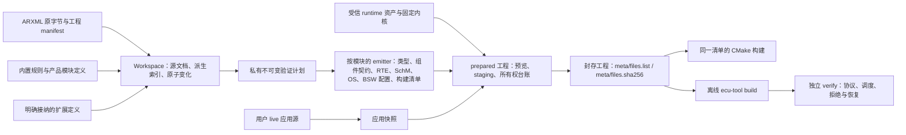

# 架构

本目录描述 Classic CAN 配置工作台的**当前**架构、仍然有效的所有权与状态不变量，以及正在实施的主线收敛方向。标注“目标（实施中）”的内容尚未在 `master` 落地，不能当作现有能力；其余段落描述当前代码。重大决定的背景与取舍见 [ADR](../adr/)，各篇只给出结论并链接。

运行时细节、命令和标准条款不在本目录重复：

- 运行时与主机执行边界：[runtime/README.md](../../runtime/README.md)、[runtime/os/README.md](../../runtime/os/README.md)
- 标准输入计划的实现说明：[core/src/integration/README.md](../../core/src/integration/README.md)
- 标准基线、官方资料位置与模块义务索引：[standards/](../standards/README.md)
- 测试入口与前置条件：[development/testing/](../development/testing/README.md)；环境：[development/environment.md](../development/environment.md)
- 资产摘要、许可与发布：[maintainers/](../maintainers/)

## 文档索引

| 篇 | 内容 |
| --- | --- |
| [状态与所有权不变量](invariants.md) | 配置与身份、计划与生成、应用源码与交付、工作台状态 |
| [运行时架构](runtime.md) | 分层与接口分离、调度与执行所有者（含批次协议）、模块状态所有权、当前支持剖面 |
| [目标、工具链与交付](targets-and-delivery.md) | 受控主机目标与工具链边界、交付包与离线接收 |
| [主线收敛与新基线](mainline.md) | 单一生成主线、兼容策略、已删除的平行实现、Emitter 规则、仓库组织、生成工程布局、CI 门禁 |

## 系统组成

| 位置 | 职责 | 不负责 |
| --- | --- | --- |
| `core/` | Rust 核心：ARXML 解析与源安全、对象／引用图、内置规则与模块定义、跨模块校验、私有验证计划、C 生成、封存与交接、受管外部进程 | 界面状态；用户算法 |
| `src-tauri/` | 桌面后端：`AppState`／`Session`／`Operation`、IPC、设置、受管长任务 | 配置语义（只调用核心） |
| `ui/` | React 工作台：唯一 `useWorkbench` reducer、菜单／树／文档／检查器、预览与确认 | 业务身份、校验结论、配置副本 |
| `runtime/` | 随生成工程交付的 C99 运行时：自有 BSW、OS 语义层与 FreeRTOS backend、ECU 执行适配、主机适配、模板、交付资产清单、离线工具入口 | 配置解析；在构建时取浮动依赖 |
| `third_party/freertos/` | 固定 FreeRTOS 内核源码、来源摘要与 MIT 许可 | 汽车 OS 语义 |
| `tools/python/src/` | `ecu_tools`（随包交付的离线 build／verify）与 `autosar_tooling`（开发 CLI） | 产品配置语义 |
| `tests/` | Python 普通／进程／原生测试与桌面测试 | — |
| `scripts/` | 官方资料收集与核验 | 产品运行依赖 |

部署形态是本地 Windows／Linux 桌面应用加离线 ECU 工程，没有云服务、账号、遥测或常驻代理。

## 数据流

| 阶段 | 唯一输入 → 输出 | 失败行为 |
| --- | --- | --- |
| 打开／编辑 | 源文件原字节 → Workspace（saved／current 字节、派生对象图、定义索引） | source-safety 失败拒绝打开；无法安全解释的内容只读，原字节保留 |
| 校验 | Workspace＋`RuleSetIdentity`＋`definitionFingerprint` → 分范围诊断 | 未覆盖为 `unsupported`，未执行为 `not_run`，不藏为通过 |
| 计划 | 已校验输入＋目标 → 私有 `ValidatedIntegrationPlan` | 全有或全无；失败不产生输出、不改变会话 |
| 生成 | 计划 → 源码工件（不运行编译器、不读官方档案） | 缺生产者／消费者、符号碰撞、调度矛盾在生成前拒绝，不落半套工程 |
| 准备与封存 | 预览字节＋应用快照＋受信资产 → 新目录中的封存工程 | 目标已存在不覆盖；确认身份过期拒绝 |
| 构建／验证 | 封存工程＋固定工具链身份 → 程序与行为证据 | 工具身份不符、篡改、额外文件或链接逃逸拒绝；未运行与失败分开 |

## 已知差距与未验证范围

- 生成 C 的自动分析完整，但源码结果 `passed=false`；221 项 MISRA 人工评估未完成（[ADR 0008](../adr/0008-misra-baseline-and-no-deviation.md)）。
- 各模块对 R24-11 SWS／ECUC／BSW General 的逐条全文审计未完成；已核定条款见[标准基线](../standards/README.md)。
- 完整 Nm／CanNm／CanSM、同类型多实例、嵌套组合／delegation、不同周期／offset、队列／mode／异步 C/S、29 位／FD／多通道 CAN 未支持，输入在生成前拒绝。
- MCU、硬实时、真实 ISR／段放置、安装包、功能安全与认证均未验证，不由主机结果推定。
- 工作台内运行生成 ECU 的入口在主线收敛后重建（见[已删除的平行实现](mainline.md#删除的平行实现已完成33)）。

## ADR 索引

| 编号 | 决定 | 状态 |
| --- | --- | --- |
| [0001](../adr/0001-planning-in-github-issues-and-docs.md) | 规划与任务跟踪从 BMad 迁到 GitHub Issues 与 `docs/` | 已接受 |
| [0002](../adr/0002-fixed-standard-baseline-r24-11.md) | 固定标准基线 CP／FO R24-11 与 C99 | 已接受 |
| [0003](../adr/0003-original-bytes-and-single-validated-plan.md) | ARXML 原字节为配置权威，唯一私有验证计划 | 已接受 |
| [0004](../adr/0004-freertos-kernel-with-own-os-semantics.md) | OS：固定 FreeRTOS 内核＋自有 AUTOSAR OS 语义（SC1） | 已接受 |
| [0005](../adr/0005-controlled-host-targets.md) | 受控主机目标 Windows／Linux 与证据边界 | 已接受 |
| [0006](../adr/0006-builtin-rules-without-official-archives.md) | 内置规则与产品模块定义，日常使用不需官方档案 | 已接受 |
| [0007](../adr/0007-live-and-sealed-application-source.md) | 用户应用源 live／sealed 所有权 | 已接受 |
| [0008](../adr/0008-misra-baseline-and-no-deviation.md) | MISRA C:2012 修订基线与偏离审批 | 已接受 |
| [0009](../adr/0009-standard-private-and-host-interface-separation.md) | 标准公共面、模块私有状态与主机适配分离 | 已接受 |
| [0010](../adr/0010-single-generation-mainline.md) | 单一生成主线 | 已接受，实施中 |
| [0011](../adr/0011-no-backward-compatibility-before-stable.md) | 稳定版本前不保留向后兼容 | 已接受，实施中 |
| [0012](../adr/0012-remove-external-xsd-mod-mode.md) | 删除外部 XSD／MOD 校验模式，XSD 只作测试对照 | 已接受，已实施 |
| [0013](../adr/0013-remove-frame-signal-host-chain.md) | 删除帧／信号 host 链路与“主机运行”页 | 已接受，已实施 |
| [0014](../adr/0014-emitter-rules.md) | Emitter 规则 | 已接受，实施中 |
| [0015](../adr/0015-repository-code-organization.md) | 仓库代码组织 | 已接受，实施中 |
| [0016](../adr/0016-generated-project-layout-by-ownership.md) | 生成工程按所有权布局并提供 CMake | 已接受，已实施 |
| [0017](../adr/0017-requirement-disposition-in-tests-and-standards.md) | 条款处置写在测试与标准基线文档，核算结果现算 | 已接受，已实施 |
| [0018](../adr/0018-per-module-exclusive-areas-without-cross-module-locking.md) | 独占区按模块划分，持区期间不调用其他模块 | 已接受 |
