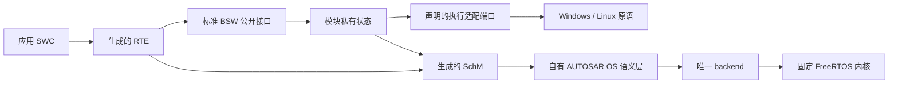

# 运行时架构

本篇属于[架构](README.md)：标注“目标（实施中）”的内容尚未在 `master` 落地，其余描述当前代码；决定的背景与取舍见 [ADR](../adr/)。

## 分层与接口分离

- **标准公共面、模块私有面、主机适配和测试控制分别组织**（[ADR 0009](../adr/0009-standard-private-and-host-interface-separation.md)）。对外使用 AUTOSAR 标准名称的接口满足适用的标准签名与语义；主机注入、时钟、输出和故障控制通过明确适配接口提供，不侵入标准头。私有状态不向应用暴露。改名、加 typedef 或空壳接口不算标准对齐。
- **测试控制只进测试构建。** 私有 `OS_*_TESTS`／`ECU_TARGET_TESTS`、`OS_HOST_FAILURE_TESTS` 与 `--control-source` 只用于 `probe`／`test` 模式；生产 HostBatch 拒绝它们。
- 通用 BSW 不直接调用 FreeRTOS 或平台线程 API；平台原语经声明的适配边界提供。

## 调度、时间与执行所有者

- **唯一调度 backend**（[ADR 0004](../adr/0004-freertos-kernel-with-own-os-semantics.md)）。固定 FreeRTOS 内核拥有实际 ready 队列、Running 裁定、抢占和上下文切换；自有 OS 层维护汽车对象状态（激活请求 FIFO、事件、资源、Counter／Alarm／ScheduleTable、错误与 Hook），经唯一 backend 驱动内核就绪性与优先级，不另建 runnable 选择器。目标等级为单核 SC1，参考配置 Extended Status。
- **受控时间**（[ADR 0005](../adr/0005-controlled-host-targets.md)）。主机目标的时间模式为 `controlled_logical_ms`：逻辑 epoch 为 uint64 毫秒，控制面逐个请求 1 ms tick，并等内核计数、Counter 动作、周期工作和输出确认到达静止点后才推进下一 tick。控制面等待 tick 时，目标发布待确认输出会立即唤醒它，逐 tick 往返不依赖宿主定时等待的粒度。墙钟 timer 不驱动汽车时间；宿主 watchdog 只控制测试进程存活。
- **单一执行所有者。** 通信开放后，唯一 Extended `Task_Ecu` 串行拥有应用与 BSW 可变状态。主机 bridge、模拟 ISR、内核隐藏任务和监测线程只提交已复制的记录或设置事件，不调用 BSW／SWC。阻塞 I/O 留在宿主桥，不进入被调度任务。
- **批次协议。** HostBatch 单批有界输入；同刻顺序为“先注入该 epoch 输入、再推进 tick”，同 epoch 重复提交不重跑周期工作。只有宿主输出实际 write／flush 成功才提交对应 PDU 的 TxConfirmation；在某 epoch 周期之前发出的帧，其确认在该周期之后按序提交，不随宿主线程的确认时机变化。`COMMIT_OK` 要求 `Task_Ecu` 已实际回到 Waiting，且输入、tick、输出与确认全部排空。当前上限（`runtime/ecu/include/Ecu_HostBatch.h`、`Ecu_HostBridge.h`、`Ecu_Target.h`）：每批 256 条消息、单批跨度 1000 ms、输出队列 256 条、每个 COMMIT 宿主 watchdog 5000 ms。超容量、epoch 倒退、序号溢出或协议错误在状态改变前整体拒绝；运行中输出溢出、输出失败或 watchdog 到期是目标故障，关闭 ECU，不继续虚拟时间。职责按三层划分：`Ecu_HostBatch` 解码并暂存一批输入；`Ecu_HostBridge` 负责 admission、逐 tick 推进、输出和收据，admission 拒绝时由它丢弃暂存输入；`Ecu_Target` 是目标 owner，持有邮箱、输出队列和 Waiting 时的完成记录。main 只负责读写行协议。
- **启动与退役。** 生成的 bootstrap 分 8 个初始化阶段（SchM、Det、Can、CanIf＋BusSM、LSduR＋PduR、Com＋ComM＋BswM、CanTp＋Dcm（仅在配置诊断传输时）、RTE 与通信启动）。任一阶段失败时，ECU 以 `ShutdownOS(E_OS_STATE)` 关闭，不产生输出；退役只针对已经开始的阶段，按逆序执行。测试构建可在每个阶段前注入失败。
- **锁协议**（[ADR 0018](../adr/0018-per-module-exclusive-areas-without-cross-module-locking.md)）。每个有可变状态的模块只进入自己的 SchM exclusive area，区只保护本模块数据；持区期间不调用其他模块、不嵌套、不重入。取消、恰一次确认与迟到回调由模块自有协议保证（Tx 台账与取消代数、`lower_pending`、单飞冲刷），不依赖共享锁。不以“单 owner”假设删除保护，也不一律用 FreeRTOS mutex 代替 OSEK resource。全部模块已迁移（[#121](https://github.com/g1331/autsaro/issues/121)）：Can 驱动、CanIf、Det、PduR、LSduR、Com、CanTp、Dcm、ComM、BswM、主机 BusSM 与生成 SchM 的模式数据各用自己的区，主机上各为一把独立的锁，持有时再进入任何区都会终止进程；旧的共享递归锁已删除。
- **真实执行栈。** 声明 SC1 的目标须监测实际线程栈：Windows 用原生线程栈边界与保护页，Linux 用独立 mmap 栈与 guard；FreeRTOS 配置栈数组不是实际执行栈。栈故障进入 `E_OS_STACKFAULT` 关闭路径。

## 模块状态所有权

| 所有者 | 拥有的状态 |
| --- | --- |
| Can driver | 控制器模式、pending TX／RX、复制帧、确认 token、生命周期 |
| CanIf | controller／PDU mode、路由过滤；上下层 PDU 命名空间分开 |
| LSduR／PduR | const 路由配置；不持数据缓冲（无 Tx buffering） |
| CanTp | 收发连接状态、序号、计时、接收帧队列、Tx N-PDU 占用与代次 |
| COM | 信号值、Rx group／DM、计时、生命周期 |
| Dcm | 会话、request／response buffer、诊断 admission |
| ComM／BswM／Det | 通道请求与当前模式；mode 输入与规则处理；runtime 报告 |
| RTE | 接收端初值／last／received／expired 状态、应用快照的发布 |
| OS／backend | 任务与汽车对象状态、调度、真实栈 |
| ECU 执行适配 | 批次 admission、epoch、ticket、输出队列、收据 |
| 用户应用 | 自身算法状态（live 源由用户拥有） |

两个模块不得拥有同一可变状态；拆分文件时保留各自的独占区与请求结算协议。

## 独占区协议

独占区遵循 [ADR 0018](../adr/0018-per-module-exclusive-areas-without-cross-module-locking.md)：模块只进入自己的区，持区期间不调用其他模块、不嵌套；主机适配检测嵌套并让测试失败。

- 把跨模块调用移出区时，原先由共享锁兜住的保证改由本模块协议提供：占用后调用、调用后结算，单飞有序发布，迟到事件按当前真实状态处理。例如重启后才送达的 bus-off，CanIf 仍执行标准规定的反应，由上层状态机按控制器实际状态恢复，不在下层违背标准丢弃事件。不能只在回调前后检查 lifetime。
- 去掉上层串行化后复核下层的“忙”语义：区只护数据时按正常方式进入，拒绝只反映真实资源占用，不能用 try-lock 把锁竞争报告成忙（如 `Can_Write` 只在发送槽占用时返回 `CAN_BUSY`）。主机 Can 驱动在 `TxConfirmation` 回调返回前仍占用该发送槽，上层不能在确认回调内经同一 N-PDU 发送下一帧（会得到 `CAN_BUSY`）：确认只结算状态，下一帧留给本模块主函数，测试按主函数推进核对。
- 区外调用的准入在一个临界区内判定并提交，作为与模式通知、重启的唯一排序点；不持锁调用时窗口无法消除，不加只为让 `--wrap` 注入点得到确定结果的二次检查。为新的并发或重启情形加标志、计数器前，先考虑并入已有状态枚举或请求代次。
- 用真实线程握手在 `SchM_Exit_*` 之后、进入消费者之前暂停，证明其他上下文能在窗口内完成、结果恰一次且状态收敛，并保留重入取消用例。

## 主机终止、流协议与激活重启

主机适配的历史偏离草案由 [#60](https://github.com/g1331/autsaro/issues/60) 跟踪。D-10／D-34 是历史标识，当前判断依据实际调用与固定 MISRA C:2012 Third Edition＋AMD1–AMD4／TC1–TC2、C99。原件已可读，身份及持久保存入口见[标准基线](../standards/README.md)；资料可用、规范裁决、源码整改和完整符合分别证明。[ADR 0023](../adr/0023-autosar-required-conflict-disposition.md) 不提供主机自动豁免。

### 锁失败与停止策略（D-10）

`runtime/host/src/Can_HostLock.c` 为生成 SchM、通信栈、诊断栈、模式数据和主机 BusSM 提供独立锁。void Enter／Exit 只有成功取得／释放保护或终止两种结果，不能忽略故障返回或用 `CAN_BUSY` 代替保护。每线程的 owner token 同时记录“是否持区”和具体区；任何同区／跨区嵌套、非法 area、无 owner 或错区 Exit 都在接触对应平台锁前拒绝。退出必须由原线程匹配原区，不能由其他线程代为释放。

Linux 使用 `pthread_once` 与默认非递归 mutex，ready 仅在初始化成功后发布。既有 strict-area 协议不允许递归，因此无需递归属性和 `_XOPEN_SOURCE`。这消除了该 TU 的 R21.1 宏操作，未把同一宏移到编译参数；C99 独立消费者不带 feature 宏编译并执行。Windows 保留 once／critical section，同样由 owner token 限定为严格不嵌套的区。正常竞争仍阻塞到取得锁，不伪报 busy；once、初始化、加锁／解锁失败终止进程。

`Can_Fatal` 与 `Det_HostHalt` 直接使用平台进程停止：Linux `_exit(134)`（受控 glibc 的进程级退出），Windows `TerminateProcess(GetCurrentProcess(), 134)`；Windows 自终止失败时 trap。它们不调用标准终止函数，不执行 CRT 清理、stdio、新锁或可能损坏的 OS／SchM 关闭链。集成方以实际进程退出码 **134** 识别此类故障；不再使用 SIGABRT、用户 signal handler 或 core dump 作为该故障的观察契约。Windows 平台拒绝自终止的 trap 回退也须按失败退出处理，不要求其状态仍为 134。

Det 仍在全部开发 hooks 按顺序返回后停止；未初始化和递归报告直接停止，runtime 报告仍可返回。R24-11 Det §7.3 的停止和通知义务、PDF 第32–33页图9.1–9.5 及 SpecificationsARXML 正文都不要求 `abort`。平台适配替换满足这些义务而消除 R21.8 的标准终止调用，不使用偏离注释或 suppression。`runtime_contracts::det_standard_consumer_executes_runtime_and_halt_contracts` 检查通知顺序及真实退出状态；`test_host_boundaries.py` 分别验证替换平台调用后的错误传播、未替换生产停止（含已安装 SIGABRT handler／CRT cleanup）、owner 拒绝和所有区的真实线程竞争。

### 四条规则的修订与剩余整改

下列定位是本项逐条核对范围，原文不入库；完整源码行／反例／检查证据留在实施 PR。四条均为 Required，没有本项主机自动例外；不从本表推导其他规则或采用代码已评估。

| 规则 | 修订合成与本项结论 |
| --- | --- |
| R21.1 | 2013 主文印刷页165–166；TC1 页10 增加 R20.5 交叉引用；AMD2 §2.10、AMD2.27 页9 扩充 C11 适用性／来源。AMD1／AMD3／AMD4／TC2 没有增加本项 feature 宏例外。锁 TU 已去除 `_XOPEN_SOURCE`；OS 其他 feature 宏仍按各自真实闭包在 #60 评估，不能批量视为合规。 |
| R21.4 | 主文页168；AMD2 §2.10、AMD2.27 页10 扩充 C11 适用性／来源；AMD3 §3.1.2、AMD3.67 页43 同时禁止包含 setjmp.h 和使用其规定设施，无本项 restart 例外。backend 已删除 setjmp／longjmp，唯一 port 使用原生上下文恢复同 Task 入口；没有把禁止设施移到包装层。 |
| R21.6 | 主文页168–169，覆盖 stdio 函数及 C99 指定的宽字符 I/O；AMD2 §2.10、AMD2.27 页10 扩充 C11 适用性／来源，AMD2.79 页16 替换首段 Amplification，明确覆盖 stdio.h 规定的函数及 wchar.h 中的宽字符等价函数；其余修订没有本项流协议例外。HostBatch／probe／OS 报告已用原生字节 I/O 和有界格式化替代这些调用；这不替代其他规则评估。 |
| R21.8 | 主文页169；AMD1 §3 页17 移除 getenv；TC1 页11 修正表述；AMD2 §2.10.41（AMD2.81）页17 整条替换为 abort、exit、_Exit、quick_exit，后续 AMD3／AMD4／TC2 未再改变集合。锁与 Det 已去除 abort；R21.8 原文按所列标识符限制使用；POSIX `_exit` 不在该集合。受控 glibc 的 `_exit`／`_Exit` 可共享实现，这不是实现隔离证明；选择平台 API 的依据是明确的进程级停止及不执行 CRT 清理的契约与真实消费者测试，其他规则仍须独立评估。固定 checker 的 getenv 旧诊断及 _Exit／quick_exit 漏检仍原样保留。 |

流迁移与 restart 分别验证生产完成边界与 port／第三方身份。#60 仍拥有未关闭的保留 feature 宏整改；#58 继续拥有全部221项、其他源码行及采用代码的评估，#200 保留目标端口停机差距。

### 主机 I/O 与故障报告（D-34／E4-HOST-REPORT）

HostBatch、probe、正常 OS 生命周期与栈报告通过 `Os_HostIo.h` 使用原生标准句柄和调用方持有的有界记录。Linux 读取文件描述符，Windows 读取 HANDLE，不经过 CRT 文本翻译。`Os_HostServices.c` 不再设置 CRT 标准流模式；使用 CRT 的应用或测试消费者自行完成自己的缓冲输出。已删除的存储实现不属于本闭包，后续存储能力由 [R7](../roadmap/README.md)／[#124](https://github.com/g1331/autsaro/issues/124) 承接。

HostBatch 逐字节保留 NUL、排空过长行、移除行尾 CR，区分 EOF 与实际输入错误；输入错误进入故障关闭。十进制字段支持完整 uint64 范围，十六进制字段拒绝无效宽度和截断，容量错误锁存并拒绝发布记录前缀。原生写入处理部分完成、EINTR、零进展和句柄关闭；Linux 仅阻塞调用线程的 SIGPIPE 并消费本次断管产生的信号，保留调用前已有的 pending 信号及原来的屏蔽集合。

`Ecu_HostBridge.c:pump` 只在 sink 把完整 OUT 记录实际写出后调用 `Ecu_TargetConfirmOutput`；probe 同样先完成输出再确认。写入失败可能留下可见前缀，但不能确认输出或发布成功收据。无 stdio 缓冲后的完成边界是全部字节交给平台输出成功，不额外要求管道协议进行磁盘同步。正式 HostBatch／probe、测试构建的初始化和退役记录均使用同一输出入口。

正常关闭在 `report_and_exit` 依次调用 ShutdownHook、栈报告和 lifecycle 报告，后两者均检查完整输出；报告失败把原本成功的退出转为 `E_OS_STATE`，已有失败原因保持。控制器耗尽后的 `Os_StackFatalExit` 保留预分配缓冲、首次故障记录和原生停止，只重试剩余字节及 EINTR，stdout 失败后尝试 stderr。该路径不调用 stdio、不分配内存或取得新的应用锁。Linux guard handler 对非本模块 guard 的异常直接退出；自己的 guard fault 发布记录并永久停放 actor。

### 激活重启（E4-HOST-RESTART）

唯一 FreeRTOS port 的 `vPortRunTask` 在 Task 自己的原生线程中保存入口上下文，根帧保持存活；Linux 使用 `getcontext`／`setcontext`，Windows 使用 `RtlCaptureContext`／`RtlRestoreContext`（异常参数为 NULL，不使用 jump buffer）。`complete_activation` 仍先结算 FIFO、资源、PostTaskHook 和 ready sequence，完成 suspend／yield、离开 critical 后才调用不返回的 `vPortRestartTask`。错误分支继续返回原状态；missing-end 仍先报告 `E_OS_MISSINGEND`，再释放资源和结算。

恢复丢弃已完成激活的调用帧，在同线程、同物理栈重新调用 Task 入口，不创建新线程或第二调度器。ARTI 注册按真实 TCB 查找配置槽；`arti.c` 在 Task 入口比较实际线程、栈、context 映射及重复入口栈指针，`finish`／`returned-task` 独立检查成功不返回、拒绝可返回及状态顺序。上游 FreeRTOS 原件不变；两平台的生产 port 补丁及其 `source-manifest.json` 摘要随交付变更，需重新生成并构建。

保留宏尚未解决：Linux 的 `_GNU_SOURCE` 关联 futex 系统调用、signal/altstack、完整 ucontext 字段及非受控调用线程的栈查询；Windows 的 `_WIN32_WINNT` 关联系统提供的当前线程栈边界。当前 C99 消费者去除 Linux 源码和编译参数中的宏后，实际因 `syscall`、`gregs`／`REG_RSP` 和 `SA_ONSTACK` 等声明缺失拒绝编译。删除局部定义但保留 `-D_GNU_SOURCE` 不算整改；#60 的后续出口仍须提供真实平台替代并验证停车、故障栈和第三方身份，不能凭主机用途豁免。

### 解除条件与验收

固定原件已可用，不再以 #57 的 MISRA 缺件阻塞本项。后续直接从持久资料库核对对应修订及 R24-11 原文、图页，按真实调用消除剩余违反；Dcm 的 ISO 缺件不在本项闭包。OS 停机的既有差距仍由 [#200](https://github.com/g1331/autsaro/issues/200) 跟踪，不因主机进程退出而关闭。源码诊断与必要人工评估由 #58 承接，原始状态不因资料、局部整改或绿色 CI 改写。

实际修改应由独立反例证伪：锁故障不得返回且正常锁可用；HostBatch NUL／CR／过长输入、EOF／输入错误、部分输出／原生写入失败不得提前确认；终止／ChainTask 不得返回到已完成调用帧，FIFO／抢占／资源清理保持；正常和控制器耗尽的栈故障均保留报告及失败状态。复用现有 host-boundary、protocol、OS activation／finish／stack suites 与生产／TSan／ASan／UBSan 封存入口，保持 #324 的 2000 ms terminal-stop 协议和 #331 的公开接口 fuzz／重放断言。改动生成 C 后运行两平台受影响 main 和全部受影响 profile 的完整 c-check，分别报告分析完整性、原始 `passed`、新增／移除诊断与未核查项；不得用 suppression、基线新增、漏扫或更换成 checker 未识别的调用证明整改完成。

## 当前支持剖面与边界

当前只有一条生成链路：

| 链路 | 选择条件 | 说明 |
| --- | --- | --- |
| ECU 主线（`singlecore-ecu-v1`） | 内置规则校验的全部 ECU 工程，含默认模板 `standard-ecu`；一个应用 SWC 是 N＝1 的特例 | 本地 S/R、同步 C/S、同 owner 调度、每组件 live／sealed 源、标准 COM／CanIf／LSduR／PduR／CanTp／Dcm 与有界 ComM／BswM／Det |

以已删除的帧／信号 host（`host-can-v1`）、单组件（`epic4-win64-sr-cs-v1`）或主线旧名 `singlecore-multi-swc-v1` 记录的工作台工程与交付包在打开时拒绝（见第 7.2、7.3 节）。

主线剖面的首批支持范围（平坦组合、每类型一个实例、共同周期且 offset=0、`IMMEDIATE` 信号处理、唯一 EcucPartition ID0／CoreId0、11 位 Classical CAN 单通道、诊断路由全选或全不选）与拒绝边界见 [多组件剖面的已核定义务](../standards/multi-component-profile.md)。未支持的生成语义在生成前拒绝，无关有效内容原样保留。

**网络管理边界：**多组件剖面选定 NM NONE，经 host CDD BusSM（`COMM_BUS_TYPE_CDD`／`Ecu_HostBusSM`）连接真实 Can／CanIf 模式；当前没有完整 Nm、CanNm、CanSM，有界 mode 路径不能替代 NM PDU、睡眠状态机或 CanSM 协调。未来选择 `COMM_BUS_TYPE_CAN` 时须实现真正 CanSM。
