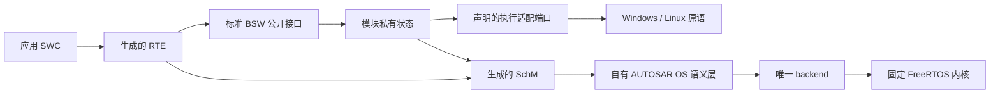

# 运行时架构

本篇属于[架构](README.md)：标注“目标（实施中）”的内容尚未在 `master` 落地，其余描述当前代码；决定的背景与取舍见 [ADR](../adr/)。

## 分层与接口分离

- **标准公共面、模块私有面、主机适配和测试控制分别组织**（[ADR 0009](../adr/0009-standard-private-and-host-interface-separation.md)）。对外使用 AUTOSAR 标准名称的接口满足适用的标准签名与语义；主机注入、时钟、输出和故障控制通过明确适配接口提供，不侵入标准头。私有状态不向应用暴露。改名、加 typedef 或空壳接口不算标准对齐。
- **测试控制只进测试构建。** 私有 `OS_*_TESTS`／`ECU_TARGET_TESTS`、`OS_HOST_FAILURE_TESTS` 与 `--control-source` 只用于 `probe`／`test` 模式；生产 HostBatch 拒绝它们。
- 通用 BSW 不直接调用 FreeRTOS 或平台线程 API；平台原语经声明的适配边界提供。

## 调度、时间与执行所有者

- **唯一调度 backend**（[ADR 0004](../adr/0004-freertos-kernel-with-own-os-semantics.md)）。固定 FreeRTOS 内核拥有实际 ready 队列、Running 裁定、抢占和上下文切换；自有 OS 层维护汽车对象状态（激活请求 FIFO、事件、资源、Counter／Alarm／ScheduleTable、错误与 Hook），经唯一 backend 驱动内核就绪性与优先级，不另建 runnable 选择器。目标等级为单核 SC1，参考配置 Extended Status。
- **受控时间**（[ADR 0005](../adr/0005-controlled-host-targets.md)）。主机目标的时间模式为 `controlled_logical_ms`：逻辑 epoch 为 uint64 毫秒，控制面逐个请求 1 ms tick，并等内核计数、Counter 动作、周期工作和输出确认到达静止点后才推进下一 tick。控制面等待 tick 时，目标发布待确认输出会立即唤醒它，逐 tick 往返不依赖宿主定时等待的粒度。墙钟 timer 不驱动汽车时间；宿主 watchdog 只控制测试进程存活。
- **单一执行所有者。** 通信开放后，唯一 Extended `Task_Ecu` 串行拥有应用与 BSW 可变状态。主机 bridge、模拟 ISR、内核隐藏任务和监测线程只提交已复制的记录或设置事件，不调用 BSW／SWC。阻塞 I/O 留在宿主桥，不进入被调度任务。
- **批次协议。** HostBatch 单批有界输入；同刻顺序为“先注入该 epoch 输入、再推进 tick”，同 epoch 重复提交不重跑周期工作。只有宿主输出实际 write／flush 成功才提交对应 PDU 的 TxConfirmation；在某 epoch 周期之前发出的帧，其确认在该周期之后按序提交，不随宿主线程的确认时机变化。`COMMIT_OK` 要求 `Task_Ecu` 已实际回到 Waiting，且输入、tick、输出与确认全部排空。当前上限（`runtime/ecu/include/Ecu_HostBatch.h`、`Ecu_HostBridge.h`、`Ecu_Target.h`）：每批 256 条消息、单批跨度 1000 ms、输出队列 256 条、每个 COMMIT 宿主 watchdog 5000 ms。超容量、epoch 倒退、序号溢出或协议错误在状态改变前整体拒绝；运行中输出溢出、输出失败或 watchdog 到期是目标故障，关闭 ECU，不继续虚拟时间。职责按三层划分：`Ecu_HostBatch` 解码并暂存一批输入；`Ecu_HostBridge` 负责 admission、逐 tick 推进、输出和收据，admission 拒绝时由它丢弃暂存输入；`Ecu_Target` 是目标 owner，持有邮箱、输出队列和 Waiting 时的完成记录。main 只负责读写行协议。
- **启动与退役。** 生成的 bootstrap 分 8 个初始化阶段（SchM、Det、Can、CanIf＋BusSM、LSduR＋PduR、Com＋ComM＋BswM、CanTp＋Dcm（仅在配置诊断传输时）、RTE 与通信启动）。任一阶段失败时，ECU 以 `ShutdownOS(E_OS_STATE)` 关闭，不产生输出；退役只针对已经开始的阶段，按逆序执行。测试构建可在每个阶段前注入失败。
- **锁协议**（[ADR 0018](../adr/0018-per-module-exclusive-areas-without-cross-module-locking.md)）。每个有可变状态的模块只进入自己的 SchM exclusive area，区只保护本模块数据；持区期间不调用其他模块、不嵌套、不重入。取消、恰一次确认与迟到回调由模块自有协议保证（Tx 台账与取消代数、`lower_pending`、单飞冲刷），不依赖共享锁。不以“单 owner”假设删除保护，也不一律用 FreeRTOS mutex 代替 OSEK resource。全部模块已迁移（[#121](https://github.com/g1331/autsaro/issues/121)）：Can 驱动、CanIf、Det、PduR、LSduR、Com、CanTp、Dcm、ComM、BswM、主机 BusSM 与生成 SchM 的模式数据各用自己的区，主机上各为一把独立的锁，持有时再进入任何区都会终止进程；旧的共享递归锁已删除。
- **真实执行栈。** 声明 SC1 的目标须监测实际线程栈：Windows 用原生线程栈边界与保护页，Linux 用独立 mmap 栈与 guard；FreeRTOS 配置栈数组不是实际执行栈。栈故障进入 `E_OS_STACKFAULT` 关闭路径。

## 模块状态所有权

| 所有者 | 拥有的状态 |
| --- | --- |
| Can driver | 控制器模式、pending TX／RX、复制帧、确认 token、生命周期 |
| CanIf | controller／PDU mode、路由过滤；上下层 PDU 命名空间分开 |
| LSduR／PduR | const 路由配置；不持数据缓冲（无 Tx buffering） |
| CanTp | 收发连接状态、序号、计时、接收帧队列、Tx N-PDU 占用与代次 |
| COM | 信号值、Rx group／DM、计时、生命周期 |
| Dcm | 会话、request／response buffer、诊断 admission |
| ComM／BswM／Det | 通道请求与当前模式；mode 输入与规则处理；runtime 报告 |
| RTE | 接收端初值／last／received／expired 状态、应用快照的发布 |
| OS／backend | 任务与汽车对象状态、调度、真实栈 |
| ECU 执行适配 | 批次 admission、epoch、ticket、输出队列、收据 |
| 用户应用 | 自身算法状态（live 源由用户拥有） |

两个模块不得拥有同一可变状态；拆分文件时保留各自的独占区与请求结算协议。

## 独占区协议

独占区遵循 [ADR 0018](../adr/0018-per-module-exclusive-areas-without-cross-module-locking.md)：模块只进入自己的区，持区期间不调用其他模块、不嵌套；主机适配检测嵌套并让测试失败。

- 把跨模块调用移出区时，原先由共享锁兜住的保证改由本模块协议提供：占用后调用、调用后结算，单飞有序发布，迟到事件按当前真实状态处理。例如重启后才送达的 bus-off，CanIf 仍执行标准规定的反应，由上层状态机按控制器实际状态恢复，不在下层违背标准丢弃事件。不能只在回调前后检查 lifetime。
- 去掉上层串行化后复核下层的“忙”语义：区只护数据时按正常方式进入，拒绝只反映真实资源占用，不能用 try-lock 把锁竞争报告成忙（如 `Can_Write` 只在发送槽占用时返回 `CAN_BUSY`）。主机 Can 驱动在 `TxConfirmation` 回调返回前仍占用该发送槽，上层不能在确认回调内经同一 N-PDU 发送下一帧（会得到 `CAN_BUSY`）：确认只结算状态，下一帧留给本模块主函数，测试按主函数推进核对。
- 区外调用的准入在一个临界区内判定并提交，作为与模式通知、重启的唯一排序点；不持锁调用时窗口无法消除，不加只为让 `--wrap` 注入点得到确定结果的二次检查。为新的并发或重启情形加标志、计数器前，先考虑并入已有状态枚举或请求代次。
- 用真实线程握手在 `SchM_Exit_*` 之后、进入消费者之前暂停，证明其他上下文能在窗口内完成、结果恰一次且状态收敛，并保留重入取消用例。

## 主机终止、流协议与激活重启

主机适配的历史偏离草案由 [#60](https://github.com/g1331/autsaro/issues/60) 跟踪。D-10／D-34 是历史问题标识，不能直接当作当前源码的规则裁决。固定基线及合法原文要求见[标准基线](../standards/README.md)与 [ADR 0008](../adr/0008-misra-baseline-and-no-deviation.md)。以下说明实现边界和候选改造的验收约束；候选尚未实现，现有调用的 MISRA 适用性与完整评估仍依赖 [#57](https://github.com/g1331/autsaro/issues/57)／[#58](https://github.com/g1331/autsaro/issues/58)。

### 锁失败与停止策略（D-10）

`runtime/host/src/Can_HostLock.c` 为生成 SchM、通信栈、诊断栈、模式数据和主机 BusSM 提供独立锁。void Enter／Exit 的调用方以“已取得／已释放保护”继续执行，不能接收可恢复的锁错误。`Can_Fatal` 通过 `abort` 终止进程，覆盖 once、mutex 属性与初始化、加锁／解锁失败，以及非法 area 和 strict-area 嵌套。`Can_InitRecursive` 仅在属性释放等步骤成功后发布 ready，失败时尝试销毁已创建 mutex。当前机制不是旧文件中仅有的三个 abort 点。

若授权原文核对要求替换终止调用，候选是锁提供者内部的平台 fatal 原语：Windows／Linux 各自停止整个 ECU 进程，永不返回，也不进入可能尚未初始化或已损坏的 OS／SchM 关闭链。实施前须确定并验证信号／退出状态、core dump、检测器及进程 owner 的观察契约。不能把锁失败映射成 `CAN_BUSY`、忽略失败后返回、等待健康控制器无限期接管，或仅把 abort 藏到另一个包装中。

Linux 在包含 pthread 头之前定义 `_XOPEN_SOURCE=700`，用于取得递归 mutex 的声明。候选改造须先在锁翻译单元及全部直接 C99 consumer 中验证所需接口的真实可见性，再按授权原文核对保留名字及适用例外；把同一宏移到编译参数不证明问题已消除。不能改用普通 mutex 后保留递归的初始化假设，也不能删掉嵌套检测来迎合测试。

`Det_HostHalt` 的 abort 是另一条真实停止路径：开发报告依次执行 hooks 后停止，未初始化和递归报告同样停止。锁提供者的替换不能使它返回、改变 hooks 次序或把停止改成成功退出。现有 `runtime_contracts::det_standard_consumer_executes_runtime_and_halt_contracts` 检查真实停止状态；`test_host_boundaries.py` 通过替换平台故障入口验证每条锁失败与嵌套策略，后者不等于验证未替换的生产 abort。

### 主机 I/O 与故障报告（D-34／E4-HOST-REPORT）

当前交付的 stdio 使用者包括 `runtime/ecu/src/ecu_host_batch.c`、`ecu_probe.c`、`runtime/os/src/Os_Backend.c`、`Os_Stack.c`、`host/linux/Os_StackLinux.c`，以及设置 Windows 二进制标准流的 `Os_HostServices.c`。已删除的 `NvM_HostStorage.c`、`Security.c` 与 `ecu_host_main.c` 不属于当前闭包；后续存储能力由 [R7](../roadmap/README.md)／[#124](https://github.com/g1331/autsaro/issues/124) 承接，不为处理旧草案恢复它们。

HostBatch 的控制线程逐字节读取输入，保留嵌入 NUL，排空过长行，并区分 EOF 与输入错误。输出 sink 完成格式化并 flush 成功后，`Ecu_HostBridge.c:pump` 才调用 `Ecu_TargetConfirmOutput`；协议拒绝、运行中输出失败及成功收据有各自的效果。probe 的输出与测试构建的初始化／退役记录也被工具消费。只删掉日志、把错误当 EOF，或在缓冲写入后提前确认，都会改变可观察契约。

若原文核对要求消除这些 stdio 调用，候选是既有 host 层内的有界字节读写与格式化：Windows 使用标准 HANDLE，Linux 使用文件描述符；按部分读写、EOF、中断、关闭管道及实际错误处理结果。格式化须保持十进制／十六进制字段、精确字节数和容量拒绝；确认只能发生在完整记录实际输出成功后。替换后没有 stdio 缓冲，原 flush 的完成边界仍须由平台写入完成来承担，不把额外磁盘同步引入管道协议。该方案涉及两平台生产 HostBatch、probe、test 与验证器，不能只迁移一个 printf，或仅转移 stdio 的文件位置。

正常关闭由 `report_and_exit` 调用 `Os_StackReport`、输出 lifecycle 并检查 flush；输出失败会使原本成功的退出变为 `E_OS_STATE`。耗尽控制器后的 `Os_StackFatalExit` 则已用有界手工格式化和 Linux `write`／Windows `WriteFile`，失败时尝试 stderr，再终止进程；不能把 stdio 或新锁引入此路径。Linux guard handler 对非本模块 guard 的异常直接退出；自己的 guard fault 发布记录并永久停放 actor。任何改造均须保留首次故障记录、关闭 admission、备用控制器、不可恢复时的终止与失败状态。

### 激活重启（E4-HOST-RESTART）

`Os_Backend.c:task_entry` 在每个 Task 自己的原生线程建立 restart frame。TerminateTask、ChainTask 与 missing-end 经 `complete_activation` 结算激活 FIFO、资源和 ready sequence，完成 suspend／yield 后才 longjmp 到同一 Task 的 trampoline，丢弃已完成应用的调用帧；应用和生成 Runnable 不持有 restart frame。

候选替代须由唯一 FreeRTOS port 提供同 Task 的执行栈重启，在现有结算点切换到该 Task 的入口上下文，保持线程／原生栈及 ARTI 身份、FIFO 次序、抢占、资源释放、错误返回和成功终止不返回的行为。不能用普通 return 模拟 TerminateTask，不能递归调用 entry，也不能每次激活新建线程或另设调度器。修改 port 会影响固定内核补丁和第三方身份，须在实施时独立审阅；本方案不预先授权或追认这些字节的变化。缺失的规则全文及 port 语义证据未补齐前保留当前 trampoline。

### 解除条件与验收

[#57](https://github.com/g1331/autsaro/issues/57) 的资料提供方须提供合法可读的 MISRA C:2012 Third Edition 与适用 AMD1–AMD4／TC1–TC2 正文，核定版次、摘要及相关修订位置；需核对 R21.1／R21.6／R21.8、restart 涉及的 R21.4、适用例外及主机代码角色。技能目录、旧 addon 诊断和公开摘要均不替代该来源。AUTOSAR 义务发生变化时，还须取得固定 R24-11 对应 SpecificationsARXML／PDF 原文；OS 停机的现有差距仍由 [#200](https://github.com/g1331/autsaro/issues/200) 跟踪，不因主机进程退出而关闭。

资料到位后，#60 的实施者按真实调用逐项决定是否适用、如何改造，并在 #58 保留逐行源码诊断与人工评估。实际修改应由独立反例证伪：锁故障不得返回且正常锁可用；HostBatch NUL／CR／过长输入、EOF／输入错误、部分输出／flush 失败不得提前确认；终止／ChainTask 不得返回到已完成调用帧，FIFO／抢占／资源清理保持；正常和控制器耗尽的栈故障均保留报告及失败状态。复用现有 host-boundary、protocol、OS activation／finish／stack suites 与生产／TSan／ASan／UBSan 封存入口，保持 #324 的 2000 ms terminal-stop 协议和 #331 的公开接口 fuzz／重放断言。改动生成 C 后运行两平台受影响 main 和全部受影响 profile 的完整 c-check，分别报告分析完整性、原始 `passed`、新增／移除诊断与未核查项；不得用 suppression、基线新增、漏扫或更换成 checker 未识别的调用证明整改完成。

## 当前支持剖面与边界

当前只有一条生成链路：

| 链路 | 选择条件 | 说明 |
| --- | --- | --- |
| ECU 主线（`singlecore-ecu-v1`） | 内置规则校验的全部 ECU 工程，含默认模板 `standard-ecu`；一个应用 SWC 是 N＝1 的特例 | 本地 S/R、同步 C/S、同 owner 调度、每组件 live／sealed 源、标准 COM／CanIf／LSduR／PduR／CanTp／Dcm 与有界 ComM／BswM／Det |

以已删除的帧／信号 host（`host-can-v1`）、单组件（`epic4-win64-sr-cs-v1`）或主线旧名 `singlecore-multi-swc-v1` 记录的工作台工程与交付包在打开时拒绝（见第 7.2、7.3 节）。

主线剖面的首批支持范围（平坦组合、每类型一个实例、共同周期且 offset=0、`IMMEDIATE` 信号处理、唯一 EcucPartition ID0／CoreId0、11 位 Classical CAN 单通道、诊断路由全选或全不选）与拒绝边界见 [多组件剖面的已核定义务](../standards/multi-component-profile.md)。未支持的生成语义在生成前拒绝，无关有效内容原样保留。

**网络管理边界：**多组件剖面选定 NM NONE，经 host CDD BusSM（`COMM_BUS_TYPE_CDD`／`Ecu_HostBusSM`）连接真实 Can／CanIf 模式；当前没有完整 Nm、CanNm、CanSM，有界 mode 路径不能替代 NM PDU、睡眠状态机或 CanSM 协调。未来选择 `COMM_BUS_TYPE_CAN` 时须实现真正 CanSM。
