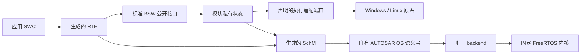

# 运行时架构

本篇属于[架构](README.md)：标注“目标（实施中）”的内容尚未在 `master` 落地，其余描述当前代码；决定的背景与取舍见 [ADR](../adr/)。

## 分层与接口分离

- **标准公共面、模块私有面、主机适配和测试控制分别组织**（[ADR 0009](../adr/0009-standard-private-and-host-interface-separation.md)）。对外使用 AUTOSAR 标准名称的接口满足适用的标准签名与语义；主机注入、时钟、输出和故障控制通过明确适配接口提供，不侵入标准头。私有状态不向应用暴露。改名、加 typedef 或空壳接口不算标准对齐。
- **测试控制只进测试构建。** 私有 `OS_*_TESTS`／`ECU_TARGET_TESTS`、`OS_HOST_FAILURE_TESTS` 与 `--control-source` 只用于 `probe`／`test` 模式；生产 HostBatch 拒绝它们。
- 通用 BSW 不直接调用 FreeRTOS 或平台线程 API；平台原语经声明的适配边界提供。

## 调度、时间与执行所有者

- **唯一调度 backend**（[ADR 0004](../adr/0004-freertos-kernel-with-own-os-semantics.md)）。固定 FreeRTOS 内核拥有实际 ready 队列、Running 裁定、抢占和上下文切换；自有 OS 层维护汽车对象状态（激活请求 FIFO、事件、资源、Counter／Alarm／ScheduleTable、错误与 Hook），经唯一 backend 驱动内核就绪性与优先级，不另建 runnable 选择器。目标等级为单核 SC1，参考配置 Extended Status。
- **受控时间**（[ADR 0005](../adr/0005-controlled-host-targets.md)）。主机目标的时间模式为 `controlled_logical_ms`：逻辑 epoch 为 uint64 毫秒，控制面逐个请求 1 ms tick，并等内核计数、Counter 动作、周期工作和输出确认到达静止点后才推进下一 tick。控制面等待 tick 时，目标发布待确认输出会立即唤醒它，逐 tick 往返不依赖宿主定时等待的粒度。墙钟 timer 不驱动汽车时间；宿主 watchdog 只控制测试进程存活。
- **单一执行所有者。** 通信开放后，唯一 Extended `Task_Ecu` 串行拥有应用与 BSW 可变状态。主机 bridge、模拟 ISR、内核隐藏任务和监测线程只提交已复制的记录或设置事件，不调用 BSW／SWC。阻塞 I/O 留在宿主桥，不进入被调度任务。
- **批次协议。** HostBatch 单批有界输入；同刻顺序为“先注入该 epoch 输入、再推进 tick”，同 epoch 重复提交不重跑周期工作。只有宿主输出实际 write／flush 成功才提交对应 PDU 的 TxConfirmation；在某 epoch 周期之前发出的帧，其确认在该周期之后按序提交，不随宿主线程的确认时机变化。`COMMIT_OK` 要求 `Task_Ecu` 已实际回到 Waiting，且输入、tick、输出与确认全部排空。当前上限（`runtime/ecu/include/Ecu_HostBatch.h`、`Ecu_HostBridge.h`、`Ecu_Target.h`）：每批 256 条消息、单批跨度 1000 ms、输出队列 256 条、每个 COMMIT 宿主 watchdog 5000 ms。超容量、epoch 倒退、序号溢出或协议错误在状态改变前整体拒绝；运行中输出溢出、输出失败或 watchdog 到期是目标故障，关闭 ECU，不继续虚拟时间。职责按三层划分：`Ecu_HostBatch` 解码并暂存一批输入；`Ecu_HostBridge` 负责 admission、逐 tick 推进、输出和收据，admission 拒绝时由它丢弃暂存输入；`Ecu_Target` 是目标 owner，持有邮箱、输出队列和 Waiting 时的完成记录。main 只负责读写行协议。
- **启动与退役。** 生成的 bootstrap 分 8 个初始化阶段（SchM、Det、Can、CanIf＋BusSM、LSduR＋PduR、Com＋ComM＋BswM、CanTp＋Dcm（仅在配置诊断传输时）、RTE 与通信启动）。任一阶段失败时，ECU 以 `ShutdownOS(E_OS_STATE)` 关闭，不产生输出；退役只针对已经开始的阶段，按逆序执行。测试构建可在每个阶段前注入失败。
- **锁协议**（[ADR 0018](../adr/0018-per-module-exclusive-areas-without-cross-module-locking.md)）。每个有可变状态的模块只进入自己的 SchM exclusive area，区只保护本模块数据；持区期间不调用其他模块、不嵌套、不重入。取消、恰一次确认与迟到回调由模块自有协议保证（Tx 台账与取消代数、`lower_pending`、单飞冲刷），不依赖共享锁。不以“单 owner”假设删除保护，也不一律用 FreeRTOS mutex 代替 OSEK resource。迁移尚未完成（[#121](https://github.com/g1331/autsaro/issues/121)）：Can 驱动、CanIf、Det 与生成 SchM 的模式数据已使用各自的区，主机上各为一把独立的锁，持有时再进入任何区都会终止进程；Com、PduR、LSduR、ComM、BswM、Dcm、CanTp 的区与主机 BusSM 在主机上仍映射到同一把递归旧锁，LSduR 在转发 CanIf 回调时持有它，供仍依赖调用方持锁的 PduR 与 Com 使用。旧锁可以包住已迁移模块的区，反过来不行。
- **真实执行栈。** 声明 SC1 的目标须监测实际线程栈：Windows 用原生线程栈边界与保护页，Linux 用独立 mmap 栈与 guard；FreeRTOS 配置栈数组不是实际执行栈。栈故障进入 `E_OS_STACKFAULT` 关闭路径。

## 模块状态所有权

| 所有者 | 拥有的状态 |
| --- | --- |
| Can driver | 控制器模式、pending TX／RX、复制帧、确认 token、生命周期 |
| CanIf | controller／PDU mode、路由过滤；上下层 PDU 命名空间分开 |
| LSduR／PduR | const 路由配置；不持数据缓冲（无 Tx buffering） |
| CanTp | 连接状态、序号、计时、下层 pending |
| COM | 信号值、Rx group／DM、计时、生命周期 |
| Dcm | 会话、request／response buffer、诊断 admission |
| ComM／BswM／Det | 通道请求与当前模式；mode 输入与规则处理；runtime 报告 |
| RTE | 本地 last／init／published 状态、应用快照的发布 |
| OS／backend | 任务与汽车对象状态、调度、真实栈 |
| ECU 执行适配 | 批次 admission、epoch、ticket、输出队列、收据 |
| 用户应用 | 自身算法状态（live 源由用户拥有） |

两个模块不得拥有同一可变状态；拆分文件时保留各自的独占区与请求结算协议。

## 当前支持剖面与边界

当前只有一条生成链路：

| 链路 | 选择条件 | 说明 |
| --- | --- | --- |
| ECU 主线（`singlecore-ecu-v1`） | 内置规则校验的全部 ECU 工程，含默认模板 `standard-ecu`；一个应用 SWC 是 N＝1 的特例 | 本地 S/R、同步 C/S、同 owner 调度、每组件 live／sealed 源、标准 COM／CanIf／LSduR／PduR／CanTp／Dcm 与有界 ComM／BswM／Det |

以已删除的帧／信号 host（`host-can-v1`）、单组件（`epic4-win64-sr-cs-v1`）或主线旧名 `singlecore-multi-swc-v1` 记录的工作台工程与交付包在打开时拒绝（见第 7.2、7.3 节）。

主线剖面的首批支持范围（平坦组合、每类型一个实例、共同周期且 offset=0、`IMMEDIATE` 信号处理、唯一 EcucPartition ID0／CoreId0、11 位 Classical CAN 单通道、诊断路由全选或全不选）与拒绝边界见 [多组件剖面的已核定义务](../standards/multi-component-profile.md)。未支持的生成语义在生成前拒绝，无关有效内容原样保留。

**网络管理边界：**多组件剖面选定 NM NONE，经 host CDD BusSM（`COMM_BUS_TYPE_CDD`／`Ecu_HostBusSM`）连接真实 Can／CanIf 模式；当前没有完整 Nm、CanNm、CanSM，有界 mode 路径不能替代 NM PDU、睡眠状态机或 CanSM 协调。未来选择 `COMM_BUS_TYPE_CAN` 时须实现真正 CanSM。
